# เว็บ Notely

## รายชื่อสมาชิกกลุ่ม (Team Members)

| ลำดับ | รหัสนิสิต | ชื่อ - นามสกุล | บทบาท
| :---: | :---: | :---: | :---: |
| 1 | 68102010213 | นางสาววริศรา ทองสุข | UI Design, HTML & CSS |
| 2 | 68102010550 | นายชนกานต์ หิรัญสุขสันต์ | UI Design, Test Case |
| 3 | 68102010553 | นางสาวพรนัชชา อออุดมยุทธ | Diagram, Backend, JSON |
| 4 | 68102010562 | นางสาวศุภธิดา พาภิรมย์ | Diagram, JavaScript, Overview |

## เสนอ
ผู้ช่วยศาสตราจารย์ ดร.วีรยุทธ เจริญเรืองกิจ

โครงงานนี้เป็นส่วนหนึ่งของการศึกษารายวิชา คพ252 วิศวกรรมซอฟต์แวร์  
มหาวิทยาลัยศรีนครินทรวิโรฒ  
ภาคการศึกษาที่ 2 ปีการศึกษา 2569

---

## ที่มาของปัญหาและความสำคัญ

ปัจจุบันการเรียนของนักศึกษาไม่ได้มีแค่การเรียนในห้องเรียนเพียงอย่างเดียว แต่ยังมีการค้นหาข้อมูลเพิ่มเติมจากอินเทอร์เน็ต รวมถึงการแลกเปลี่ยนความรู้และเอกสารการเรียนกับเพื่อนผ่านช่องทางต่าง ๆ เช่น กลุ่มแชตหรือโซเชียลมีเดีย ซึ่งบางครั้งข้อมูลที่ใช้ในการเรียนมีการกระจายอยู่หลายที่ ทำให้ค้นหาเอกสารหรือเนื้อหาที่ต้องการได้ยาก และเมื่อเวลาผ่านไปอาจทำให้ไฟล์หรือข้อมูลบางส่วนหาไม่เจอ

จากปัญหานี้จึงเกิดแนวคิดในการสร้างเว็บไซต์สำหรับแบ่งปันความรู้และเนื้อหาการเรียนสำหรับนักศึกษา โดยให้ผู้ใช้งานสามารถนำโน้ตหรือเอกสารที่มีมาแบ่งปันให้กับนักศึกษาคนอื่น ๆ สามารถเข้ามาดูและนำไปใช้ในการเรียนหรือทบทวนบทเรียนได้ นอกจากนี้ยังสามารถจัดหมวดหมู่เนื้อหาตามวิชาและเพิ่ม Tag เพื่อให้ค้นหาเนื้อหาที่สนใจได้ง่ายขึ้น

นอกจากการแบ่งปันเนื้อหาแล้ว เว็บไซต์ยังมีฟังก์ชันที่ช่วยให้ผู้ใช้งานสามารถติดตามกัน กด Like และ Comment เพื่อแลกเปลี่ยนความคิดเห็นเกี่ยวกับเนื้อหาที่แบ่งปัน รวมถึงมีระบบแจ้งเตือนเพื่อให้ผู้ใช้งานทราบเมื่อมีคนติดตาม กด Like หรือแสดงความคิดเห็นในโพสต์ของตนเอง ทำให้เว็บไซต์มีลักษณะคล้ายกับชุมชนเล็ก ๆ ที่นักศึกษาสามารถเข้ามาแบ่งปันและช่วยเหลือกันในเรื่องการเรียนได้

ในส่วนของการจัดการระบบ จะมีผู้ดูแลระบบ (Admin) สำหรับตรวจสอบและจัดการเนื้อหาหรือผู้ใช้งานที่ไม่เหมาะสม โดยผู้ใช้งานสามารถ Report เนื้อหาหรือบัญชีที่พบว่ามีปัญหา เพื่อให้ Admin เข้ามาตรวจสอบและดำเนินการตามความเหมาะสม รวมถึงมีการเก็บประวัติการแก้ไขโน้ต เพื่อให้สามารถตรวจสอบการเปลี่ยนแปลงของข้อมูลย้อนหลังได้

ดังนั้น โครงการนี้จึงจัดทำขึ้นเพื่อช่วยให้นักศึกษาสามารถแบ่งปันและเข้าถึงเนื้อหาการเรียนได้ง่ายขึ้น รวมถึงช่วยให้การค้นหาและทบทวนบทเรียนมีความสะดวกมากขึ้น และเป็นพื้นที่สำหรับให้นักศึกษาได้แลกเปลี่ยนความรู้และประสบการณ์ระหว่างกัน ซึ่งคาดว่าจะช่วยส่งเสริมการเรียนรู้ร่วมกันและสร้างสังคมแห่งการเรียนรู้ภายในเว็บไซต์ได้

## จุดประสงค์ของ Project

- เพื่อช่วยให้นักศึกษาสามารถแบ่งปันความรู้และเข้าถึงเนื้อหาการเรียนได้อย่างสะดวกและรวดเร็ว
- เพื่อส่งเสริมการเรียนรู้ร่วมกันระหว่างนักศึกษาผ่านการแลกเปลี่ยนความรู้และประสบการณ์ในการเรียน
- เพื่อช่วยเพิ่มประสิทธิภาพในการทบทวนบทเรียนและการเตรียมความพร้อมสำหรับการเรียนของนักศึกษา
- เพื่อสร้างกลุ่มหรือชุมชนแห่งการเรียนรู้ที่ผู้ใช้งานสามารถแสดงหรือแลกเปลี่ยนความคิดเห็น และช่วยเหลือกันด้านการเรียนผ่านเว็บไซต์นี้

## ประโยชน์ที่คาดว่าจะได้รับ

- เพื่อให้สามารถกำหนดความต้องการของระบบได้อย่างชัดเจน และสอดคล้องกับความต้องการของผู้ใช้งาน
- เพื่อใช้เป็นแนวทางในการออกแบบและพัฒนาระบบ ให้เป็นไปตามขอบเขตและวัตถุประสงค์ของโครงการ
- เพื่อเป็นการลดความผิดพลาดและความคลาดเคลื่อนในการพัฒนาระบบ ทำให้ผู้ที่เกี่ยวข้องมีความเข้าใจตรงกัน
- เพื่อที่จะใช้เป็นเกณฑ์ในการตรวจสอบและประเมินระบบ ว่าสามารถทำงานได้ตามความต้องการที่กำหนดไว้

## ขอบเขตของ Project

- เป็นเว็บไซต์สำหรับแบ่งปันไฟล์และเนื้อหาที่เกี่ยวข้องกับการเรียนรู้และการศึกษาเท่านั้น
- เว็บไซต์รองรับการใช้งานเฉพาะภาษาไทย
- ผู้ใช้งานสามารถอัปโหลดไฟล์และสร้างโพสต์ เพื่อแบ่งปันเนื้อหาการเรียนรู้ได้ แต่ไม่สามารถแก้ไขไฟล์ที่เผยแพร่ไปแล้วได้
- ผู้ใช้งานสามารถสร้างกลุ่มและเชิญผู้ที่ใช้งานบนเว็บไซต์เข้าร่วมกลุ่มได้เพื่อแลกเปลี่ยนและแบ่งปันเนื้อหาภายในกลุ่ม
- ผู้ใช้จะต้องเข้าสู่ระบบก่อนเข้าใช้งาน
- ผู้ใช้งานสามารถแสดงความคิดเห็นและมีส่วนร่วมกับโพสต์ของผู้ใช้งานอื่นได้
- ผู้ดูแลระบบสามารถจัดการบัญชีผู้ใช้งานและเนื้อหาภายในเว็บไซต์ เพื่อควบคุมเนื้อหาที่ไม่เหมาะสม
- ระบบการโพสต์โน้ตรองรับการอัปโหลดไฟล์ในรูปแบบ PDF, JPG และ PNG เท่านั้น

# Functional and Non-Functional Requirement

## 1. Functional Requirement

| ID | รายละเอียด |
| :--- | :--- |
| **FR-01** | ระบบรองรับการเข้าสู่ระบบ (Log in) โดยผู้ใช้งานสามารถใช้บัญชี Gmail ร่วมกับ Username และ Password ในการยืนยันตัวตนเข้าสู่ระบบ |
| **FR-02** | ผู้ใช้งานสามารถสมัครสมาชิกโดยระบุข้อมูล Username หรือ Gmail พร้อมกำหนด Password สำหรับใช้ในการเข้าสู่ระบบในครั้งถัดไป |
| **FR-03** | ระบบมีการจัดการ Token สำหรับรักษาสถานะการเข้าสู่ระบบของผู้ใช้งานเป็นระยะเวลา 1 เดือน โดยไม่ต้องกรอกข้อมูลใหม่หากยังไม่หมดอายุ |
| **FR-04** | ระบบรองรับการออกจากระบบ (Log out) โดยจะยกเลิก Token ทันทีเพื่อป้องกันการเข้าถึงบัญชีโดยไม่ได้รับอนุญาต |
| **FR-05** | ผู้ใช้งานสามารถจัดการข้อมูลส่วนตัวภายในโปรไฟล์ได้ เช่น การเปลี่ยนรูปโปรไฟล์ (Profile Picture) และการแก้ไขประวัติส่วนตัว (Bio) |
| **FR-06** | ระบบจัดเก็บข้อมูลวันเกิดและช่วงอายุของผู้ใช้งานในขั้นตอนการสมัครสมาชิก เพื่อนำมาใช้ในการจำแนกเนื้อหาตามกลุ่มเป้าหมาย |
| **FR-07** | ผู้ใช้งานสามารถกดปุ่มติดตาม (Follow) หน้าโปรไฟล์ของผู้ใช้งานรายอื่น และระบบจะปรับปรุงจำนวน Follower/Following โดยอัตโนมัติ |
| **FR-08** | ระบบรองรับการสร้างและเผยแพร่โน้ต (Notes) พร้อมอัปโหลดไฟล์เอกสารในรูปแบบ PDF, JPG, PNG และ DOC |
| **FR-09** | ผู้ใช้งานสามารถเพิ่มแท็ก (Tag) ให้กับโน้ตหรือโพสต์ เพื่อจัดหมวดหมู่และช่วยในการค้นหาเนื้อหาที่สนใจ |
| **FR-10** | ระบบรองรับการแก้ไขเนื้อหาโน้ตและการอัปเดตไฟล์เวอร์ชันปัจจุบันให้เป็นข้อมูลล่าสุด |
| **FR-11** | ระบบมีการจัดเก็บประวัติการแก้ไขของโน้ตและเอกสารย้อนหลัง พร้อมบันทึกวันและเวลาที่ดำเนินการแก้ไข |
| **FR-12** | ผู้ใช้งานสามารถมีส่วนร่วมกับโพสต์หรือโน้ตผ่านการกดถูกใจ (Like) และแสดงความคิดเห็น (Comment) |
| **FR-13** | ระบบรองรับการค้นหาข้อมูลภายในระบบ ทั้งผู้ใช้งาน (Users) โน้ต (Notes) วิชา (Subjects) และแท็ก (Tag) |
| **FR-14** | ระบบรองรับการใช้ตัวกรอง (Filter) เพื่อจำกัดขอบเขตผลการค้นหาตามเงื่อนไข เช่น ประเภทโน้ต หมวดหมู่ วิชา หรือแท็ก |
| **FR-15** | ระบบรองรับการแจ้งเตือนกิจกรรมต่างๆ ภายในระบบ (เช่น ผู้ติดตาม, การถูกใจ, ความคิดเห็น, การถูกระงับบัญชี และการลบโพสต์โดยแอดมิน) ทั้งในระบบและทาง Email |
| **FR-16** | ผู้ดูแลระบบ (Admin) มีสิทธิ์พิเศษในการบริหารจัดการ ตรวจสอบ และจัดการพฤติกรรมหรือเนื้อหาที่ไม่เหมาะสม รวมถึงการจัดการคำร้องรายงาน (Report) |

## 2. Non-Function Requirement

| ID | รายละเอียด |
| :--- | :--- |
| **NFR-08** | ระบบต้องรักษาความปลอดภัยของข้อมูลบัญชีผู้ใช้งาน โดยรหัสผ่านต้องได้รับการจัดเก็บในรูปแบบที่ปลอดภัย และไม่สามารถเข้าถึงหรือเปิดเผยรหัสผ่านของผู้ใช้งานได้โดยไม่ได้รับอนุญาต |
| **NFR-09** | ระบบต้องป้องกันการเข้าถึงข้อมูลของผู้ใช้งานโดยไม่ได้รับอนุญาต รวมถึงป้องกันการเข้าถึงบัญชีหรือข้อมูลสำคัญผ่านช่องทางที่ไม่ถูกต้อง |
| **NFR-10** | ระบบต้องมีการจัดการ Token สำหรับการเข้าสู่ระบบอย่างปลอดภัย โดย Token ต้องมีอายุการใช้งานตามที่กำหนด และเมื่อผู้ใช้งานออกจากระบบ Token เดิมต้องไม่สามารถนำกลับมาใช้เพื่อเข้าถึงบัญชีได้ |
| **NFR-11** | ระบบต้องตรวจสอบสิทธิ์ของผู้ใช้งานก่อนเข้าถึงหรือดำเนินการกับข้อมูลภายในระบบ โดยผู้ใช้งานสามารถเข้าถึงเฉพาะข้อมูลและฟังก์ชันที่ตนเองมีสิทธิ์ใช้งาน |
| **NFR-12** | ระบบต้องตรวจสอบสิทธิ์ก่อนดำเนินการอัปโหลด สร้าง แก้ไข หรือลบโน้ต เพื่อป้องกันไม่ให้ผู้ใช้งานอื่นสามารถแก้ไขหรือจัดการข้อมูลโดยไม่ได้รับอนุญาต |
| **NFR-13** | ระบบต้องแยกสิทธิ์ระหว่างผู้ใช้งานทั่วไปและผู้ดูแลระบบ (Admin) โดยฟังก์ชันสำหรับจัดการผู้ใช้งาน รายงาน และเนื้อหาที่ไม่เหมาะสมต้องสามารถเข้าถึงได้เฉพาะผู้ดูแลระบบที่ได้รับสิทธิ์เท่านั้น |
| **NFR-14** | ระบบต้องมีการออกแบบส่วนติดต่อผู้ใช้งาน (UI) ให้มีความสวยงาม ทันสมัย และมีรูปแบบที่สอดคล้องกันตลอดทั้งระบบ |
| **NFR-15** | ระบบกำหนดพื้นหลังของเว็บแอปพลิเคชันเป็นโทนสีดำอมเทาเข้ม โดยใช้สี `#313338` เป็นสีหลัก |
| **NFR-16** | กล่องโพสต์และกล่องข้อความใช้โทนสีเหลืองอมส้ม โดยข้อความภายในกล่องใช้สีดำเพื่อให้สามารถอ่านได้อย่างชัดเจน |
| **NFR-17** | ข้อความหรือองค์ประกอบข้อความบนพื้นที่หลักของระบบใช้การไล่เฉดสีในแนวทแยงจากโทนสีเหลืองไปยังสีส้ม เพื่อสร้างความโดดเด่นและความสอดคล้องของรูปแบบการออกแบบ |
| **NFR-18** | ระบบต้องมีส่วนติดต่อผู้ใช้งาน (UI) ที่เข้าใจง่าย และจัดวางฟังก์ชันต่าง ๆ อย่างเป็นระเบียบ เพื่อให้ผู้ใช้งานสามารถเรียนรู้และใช้งานระบบได้สะดวก ทั้งการค้นหา การติดตาม และการจัดการโปรไฟล์ |
| **NFR-19** | ระบบต้องสามารถตอบสนองต่อการใช้งานได้อย่างรวดเร็ว ไม่เกิดอาการกระตุกหรือหน่วงระหว่างการใช้งานในระดับที่ส่งผลกระทบต่อประสบการณ์ของผู้ใช้งาน |
| **NFR-20** | ระบบต้องสามารถเปิดและเข้าสู่เว็บไซต์ได้อย่างรวดเร็ว และใช้ทรัพยากรของอุปกรณ์อย่างเหมาะสม โดยไม่ใช้หน่วยความจำ (RAM) มากเกินความจำเป็น |
| **NFR-21** | ระบบต้องสามารถประมวลผลและแสดงผลข้อมูล เช่น โพสต์ โน้ต และผลการค้นหาได้อย่างมีประสิทธิภาพ |
| **NFR-22** | ระบบต้องสามารถรองรับผู้ใช้งานพร้อมกันได้อย่างน้อย 1,000 คน โดยระบบยังสามารถทำงานได้อย่างต่อเนื่องและไม่เกิดความผิดพลาดหรือระบบล่มจากจำนวนผู้ใช้งานที่เพิ่มขึ้น |
| **NFR-23** | ระบบต้องมีการสำรองข้อมูลอย่างสม่ำเสมอ เพื่อป้องกันการสูญหายของข้อมูลที่ผู้ใช้งานจัดเก็บไว้ภายในระบบ เช่น โน้ต ไฟล์เอกสาร และข้อมูลโปรไฟล์ |
| **NFR-24** | ระบบต้องสามารถกู้คืนข้อมูลจากข้อมูลสำรองได้เมื่อเกิดเหตุขัดข้องหรือข้อมูลสูญหาย เพื่อให้ผู้ใช้งานสามารถกลับมาใช้งานข้อมูลเดิมได้ |
| **NFR-25** | ระบบต้องสามารถแจ้งเตือนผู้ใช้งานเมื่อเกิดกิจกรรมหรือเหตุการณ์ที่เกี่ยวข้องกับบัญชีและเนื้อหาของผู้ใช้งาน โดยแสดงการแจ้งเตือนทั้งภายในระบบและผ่านทางอีเมล |
| **NFR-26** | การแจ้งเตือนต้องสามารถส่งได้อย่างเหมาะสมตามเหตุการณ์ที่เกิดขึ้น และไม่ส่งผลกระทบต่อประสิทธิภาพโดยรวมของระบบ |
| **NFR-27** | ระบบไม่จำกัดจำนวนครั้งในการอัปโหลดโน้ตของผู้ใช้งาน โดยผู้ใช้งานสามารถอัปโหลดโน้ตได้ตามความต้องการ ภายใต้เงื่อนไขและข้อจำกัดทางเทคนิคของระบบ |

# Write TOR according to the requirement

## 1. ระบบ Register, Login และ Logout

- ทุกคนจะต้องเข้าสู่ระบบได้ด้วย Username หรือ Gmail และ Password
- ผู้ใช้สามารถสมัครสมาชิกโดยระบุข้อมูล
  - Username
  - Gmail
  - Password
  - ประเภทผู้ใช้งาน
  - วันเกิด
- ผู้ใช้สามารถกดปุ่มเพื่อ Logout ได้
- ผู้ดูแลระบบสามารถเก็บข้อมูลของผู้ใช้ได้
- ผู้ดูแลระบบสามารถระงับบัญชีผู้ใช้ได้

## 2. ระบบ Profile

- ทุกคนสามารถแก้ไขข้อมูลส่วนตัวและรูปภาพโปรไฟล์ได้ตลอดเวลา
- ผู้ใช้สามารถมองเห็นและกดปุ่ม Follow ได้จากหน้าโปรไฟล์ของผู้อื่น

## 3. ระบบสร้างและเผยแพร่โน้ต

- ผู้ใช้สามารถสร้างโพสต์และอัปโหลดไฟล์ PDF, JPEG, PNG และ DOC ได้
- ผู้ใช้สามารถกดเข้าไปดูรายละเอียดและไฟล์ที่อยู่ข้างในโพสต์ของผู้อื่นได้
- ผู้ใช้สามารถเพิ่ม Tag ให้กับโพสต์เพื่อจัดหมวดหมู่เนื้อหาของโพสต์ได้
- ผู้ใช้สามารถแก้ไขเนื้อหาของโพสต์และการอัปเดตไฟล์ได้ แต่ไม่สามารถแก้ไขเนื้อหาข้างในไฟล์ที่โพสต์ไปแล้วได้
- ผู้ใช้สามารถกดถูกใจ แสดงความคิดเห็น และรายงานโพสต์ของผู้อื่นได้
- ผู้ดูแลระบบสามารถได้รับข้อมูลการรายงานของผู้ใช้ได้
- ผู้ดูแลระบบสามารถลบโพสต์ของผู้ใช้ได้

## 4. ระบบค้นหา

- ผู้ใช้สามารถค้นหาโพสต์ตามชื่อ User, Note, วิชา หรือ Tag ที่ต้องการได้
- ผู้ใช้สามารถใช้ Filter ในการกำหนดเงื่อนไขการค้นหาได้ตามประเภทของโน้ต หมวดหมู่วิชา Tag หรือประเภทผู้ใช้งาน

## 5. ระบบแจ้งเตือน

- ผู้ใช้สามารถได้รับการแจ้งเตือนผ่าน Gmail เมื่อ
  - มีผู้อื่นติดตามคุณ
  - ผู้ที่คุณติดตามได้เพิ่มโพสต์โน้ตใหม่
  - มีผู้อื่นกดถูกใจหรือแสดงความคิดเห็นในโพสต์ของผู้ใช้
  - ผู้ใช้ถูกลบโพสต์
  - ผู้ใช้ถูกระงับบัญชี

## 6. การรองรับของระบบ

- ทุกคนสามารถใช้งานได้ผ่าน Web browser บน PC, iPad และ Android
- Design ของเว็บไซต์จะต้องเปลี่ยนไปตามความเหมาะสมของขนาดหน้าจอของแต่ละ Platform

# Phase 1

# อธิบายกระบวนการทำงาน

## Process

- เก็บรวบรวม Requirements
- ทำเอกสารประกอบโครงงาน
- บันทึกวิดีโอการประชุม Retrospective

## Methods

- เก็บรวบรวม Requirements ด้วยการพูดคุยกับลูกค้า และบันทึกวิดีโอหลักฐาน จากนั้นแบ่งปันวิดีโอให้ผู้อื่น
- ทำเอกสารประกอบโครงงาน โดยโปรแกรมจัดการเอกสาร และแบ่งปันให้ผู้อื่นทำงานกันต่อ
- บันทึกวิดีโอการประชุม Retrospective โดยใช้วิธีการพูดคุย และใช้โปรแกรมบันทึกวิดีโอ และแพลตฟอร์มแบ่งปันวิดีโอ

## Tools

- เก็บรวบรวม Requirements ด้วยการพูดคุยกับลูกค้า โดยผ่านระบบ Google Meet และบันทึกวิดีโอหลักฐานด้วยโปรแกรม OBS จากนั้นแบ่งปันวิดีโอให้ผู้อื่นด้วย YouTube และ Google Drive
- ทำเอกสารประกอบโครงงาน โดยโปรแกรมจัดการเอกสาร Microsoft Word และแบ่งปันให้ผู้อื่นทำงานกันต่อด้วยโปรแกรม Discord หรือระบบ Email
- บันทึกวิดีโอการประชุม Retrospective โดยใช้วิธีการพูดคุยผ่านระบบ Google Meet และใช้โปรแกรมบันทึกวิดีโอด้วยโปรแกรม OBS และแพลตฟอร์มแบ่งปันวิดีโอด้วย YouTube


## ขั้นตอนการสรุป Retrospective

### ลิงก์การรับชม

- Review Requirement: https://www.youtube.com/watch?v=gxMcDzbEx9Q
- Retrospective: https://www.youtube.com/watch?v=2laPciH7vDY

## สรุปการประชุม

### Requirement

- กลุ่มได้รับ Requirement มาครบถ้วนตามที่กำหนด
- สมาชิกมองว่า Requirement มีรายละเอียดมากกว่าโจทย์ที่อาจารย์ต้องการในบางส่วน
- มีความกังวลว่าอาจทำงานเกินโจทย์และอาจต้องแก้ไขภายหลัง จึงควรตรวจสอบความเหมาะสมกับอาจารย์ก่อน

### Process การทำงาน

- หลังจากได้รับ Requirement ครบแล้ว ขั้นตอนถัดไปคือการเข้าสู่การออกแบบเว็บไซต์
- ก่อนเริ่มออกแบบ จะต้องให้อาจารย์ช่วยสรุปและตรวจสอบว่าแนวทางของเว็บไซต์มีความเหมาะสมและตรงตามโจทย์หรือไม่

### Feedback การทำงานของกลุ่ม

- โดยรวมสมาชิกทำงานร่วมกันได้ดี เนื่องจากทำงานด้วยกันมาตั้งแต่ปี 1
- มีการแบ่งหน้าที่ค่อนข้างชัดเจน และหากสมาชิกคนใดทำส่วนใดไม่ได้ เพื่อนในกลุ่มก็พร้อมช่วยเหลือ
- สมาชิกช่วยกันเสนอความคิดเห็น แก้ไขปัญหา และสนับสนุนกันระหว่างทำงาน
- ทุกคนมองว่าการทำงานร่วมกันครั้งนี้เป็นประสบการณ์ที่ดีและได้เรียนรู้เรื่องการทำงานเป็นทีม

### ข้อเสีย / สิ่งที่ควรปรับปรุง

- ควรบริหารและแบ่งเวลาให้ดีกว่านี้
- เนื่องจากสมาชิกมีงานหลายอย่าง จึงทำให้เริ่มทำงานใน Phase 1 ค่อนข้างช้า
- แม้สุดท้ายจะสามารถทำงานให้ทันกำหนดส่งได้ แต่ครั้งต่อไปควรเริ่มงานให้เร็วขึ้นและวางแผนเวลาให้เหมาะสมกว่าเดิม

## สรุปโดยรวม

กลุ่มสามารถทำงานร่วมกันได้ดี มีการช่วยเหลือและแบ่งงานกันอย่างเหมาะสม แต่สิ่งที่ควรพัฒนาคือ การบริหารเวลาและการเริ่มงานให้เร็วขึ้น รวมถึงควรตรวจสอบ Requirement กับอาจารย์ให้ชัดเจนก่อนลงมือทำ เพื่อป้องกันการทำงานเกินขอบเขตหรือถูกสั่งให้แก้ไขภายหลัง

# Phase 2

# อธิบายกระบวนการทำงาน

## Process

#### การแบ่งงาน
ทีมจะแบ่งงานให้สมาชิกแต่ละคนรับผิดชอบตามส่วนของระบบ เช่น Login, Profile, Note, Search และ Notification
#### การ Track Status ของ Project
ทีมจะติดตามสถานะของงานโดยแบ่งเป็น To Do, In Progress, Review และ Done เพื่อดูว่างานส่วนไหนทำไปถึงไหนแล้ว
#### การประชุม Scrum
ทีมจะมีการประชุมประมาณ สัปดาห์ละ 2 ครั้ง เพื่ออัปเดตว่างานของแต่ละคนทำถึงไหนแล้ว มีปัญหาอะไร และงานต่อไปที่จะทำคืออะไร
#### การตรวจสอบงาน
เมื่อสมาชิกทำงานเสร็จ จะมีการตรวจสอบว่างานสามารถทำงานได้ตาม Requirement หรือไม่ ก่อนที่จะนำไปรวมกับงานส่วนอื่น
#### การ Retrospective
หลังจากทำงานแต่ละช่วง ทีมจะพูดคุยกันว่าส่วนไหนทำได้ดี ส่วนไหนมีปัญหา และครั้งต่อไปควรปรับปรุงอย่างไร

## Method 

- ทีมจะทำการแบ่งงานให้สมาชิกแต่ละคนรับผิดชอบตามของส่วนของระบบต่างๆ เช่น Login, Profile, Note, Search และ Notification โดยแบ่งตามความถนัดหรือความสนใจในด้านนั้นๆ
- ทีมจะทำการติดตามสถานะของงานโดยแบ่งเป็น To Do, In Progress, Review และ Done เพื่อดูว่างานส่วนไหนทำไปถึงไหนแล้ว โดยการสร้าง Issue ขึ้นมาและจัดกระดานแบบ Kanban Chart
- ทีมมีการประชุมประมาณ สัปดาห์ละ 2 ครั้ง เพื่ออัปเดตว่างานของแต่ละคนทำถึงไหนแล้ว มีปัญหาอะไร และงานต่อไปที่จะทำคืออะไร โดยการผ่านการพูดคุยสื่อสารทั้งทางตรง (การพบปะกัน) และทางอ้อม (สื่อสารผ่านแชทสนทนา)
- เมื่อสมาชิกทำงานเสร็จ จะมีการตรวจสอบว่างานสามารถทำงานได้ตาม Requirement หรือไม่ ก่อนที่จะนำไปรวมกับงานส่วนอื่น โดยผ่านการพูดคุยและความเห็นชอบตามสมาชิกในกลุ่ม และการทดสอบ รวมถึงการสืบค้นข้อมูลว่าเหมาะสมหรือไม่
- หลังจากทำงานแต่ละช่วง ทีมจะพูดคุยกันว่าส่วนไหนทำได้ดี ส่วนไหนมีปัญหา และครั้งต่อไปควรปรับปรุงอย่างไร โดยการสื่อสารโดยตรง (การพบปะกัน) และบันทึกวิดิโอเอาไว้ เพื่อเป็นหลักฐานในการทำงานBranch หลัก
- ใช้การพูดคุยในกลุ่มเพื่อแจ้งปัญหาและอัปเดตงานระหว่างการทำ Project

## Tools

-	GitHub ใช้เก็บ Source Code และจัดการ Branch, Commit และ Pull Request
-	Git ใช้สำหรับจัดการ Version ของ Code และแยกงานของสมาชิกแต่ละคน
-	GitHub Projects ใช้สำหรับติดตามสถานะของงาน เช่น To Do, In Progress, Review และ Done
-	Discord ใช้สำหรับพูดคุยและส่งข้อมูลระหว่างสมาชิกในทีม
-	Google Meet ใช้สำหรับประชุม Scrum และพูดคุยเกี่ยวกับปัญหาของ Project
-	Microsoft Word และ Google Drive ใช้สำหรับทำและเก็บเอกสารของ Project

## UI Screenshot:
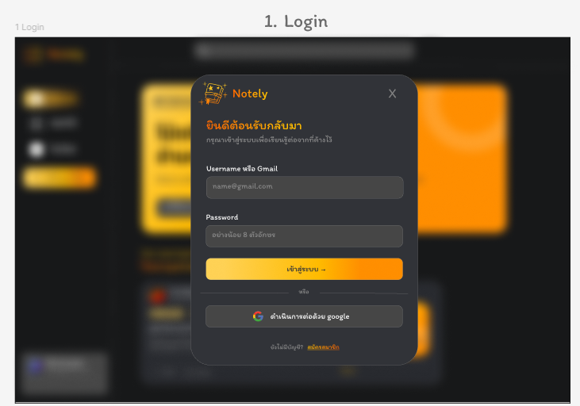


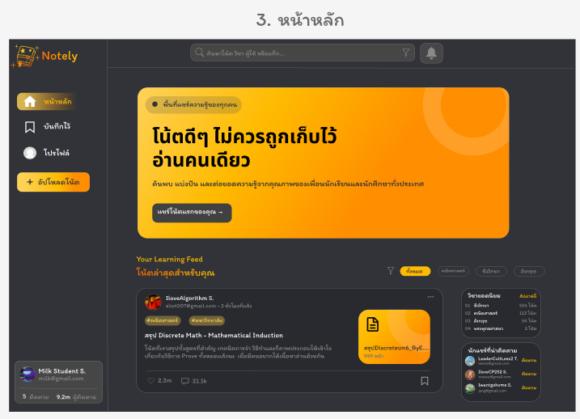


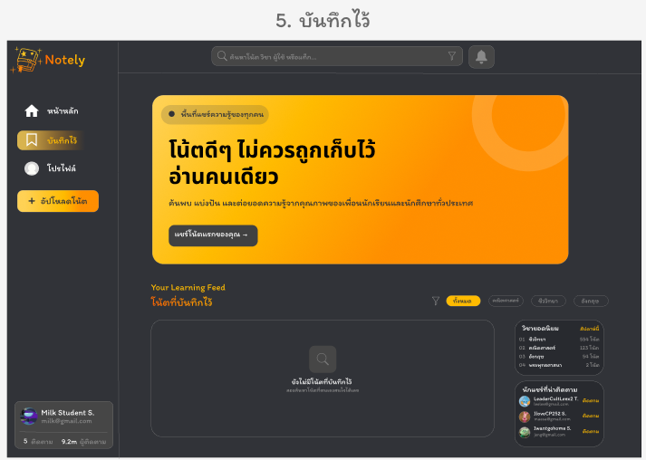

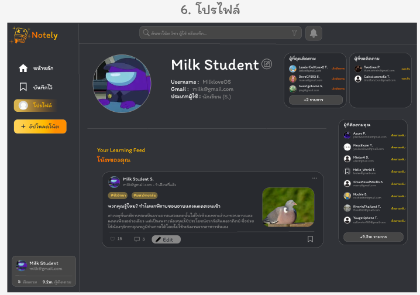


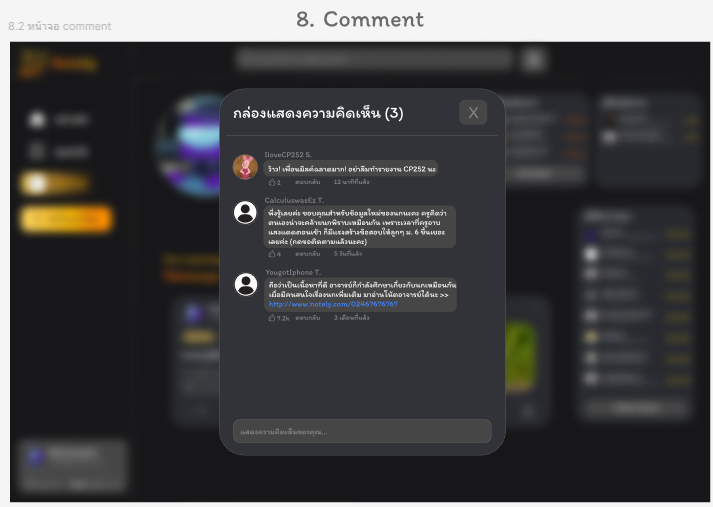


## Figma Diagram:
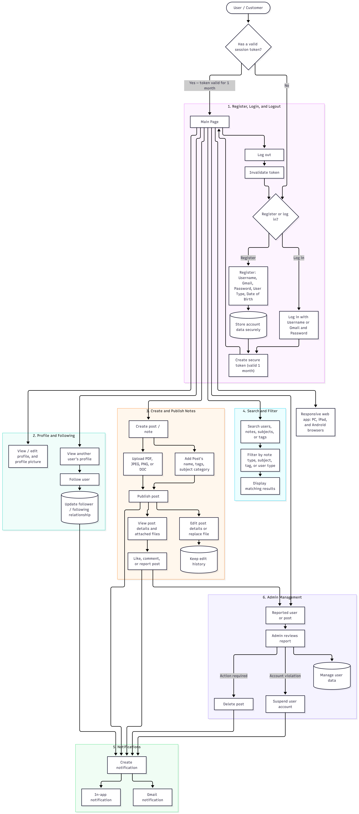


## ขั้นตอนการสรุป Retrospective

### ลิงก์การรับชม

- Retrospective: https://youtu.be/KO6X8XIttr0
- UI Screenshot: https://drive.google.com/drive/folders/1CJodyTcJAFAhOQfCgGUB0xZwUMJ2fjhN
- Figma: https://www.figma.com/design/m14GQcK81j4FF2Lk0uxtAz/Untitled?node-id=41-118&t=5Sf8MBWj5higUf9h-0
- Mermaid Diagram: https://mermaid.ai/view/c995c0b4-67b1-4fae-b0fb-cb5184ae46ba

## สรุปการประชุม

### Process การทำงาน

- สร้าง UI design โดยใช้ Figma
- หลังจากสร้าง UI แล้ว ก็นำข้อมูลไปทำเป็น diagram โดยใช้ Mermaid

### สิ่งที่ทำได้ดี 

- คนในกลุ่มสื่อสารกันได้ดี
- สมาชิกช่วยกันแก้ปัญหาเฉพาะหน้าได้ดีเยี่ยม
- หัวหน้าแบ่งงานลูกทีมได้เท่าเทียมและเหมาะสมกับงาน

### ปัญหาที่เกิดขึ้นระหว่างทำงาน/สิ่งที่ควรปรับปรุง

- การส่งงานล่าช้า เนื่องจากสถานการณ์น้ำท่วม ส่งผลกระทบต่อการใช้ชีวิตและการทำงานร่วมกันของสมาชิก
- ปัญหาสุขภาพ สมาชิกบางคนมีไข้จากสภาพอากาศที่เปลี่ยนแปลงกะทันหัน และบางคนมีอาการภูมิแพ้กำเริบ
- ข้อจำกัดด้านเวลา มีภาระงานหลายส่วนที่ต้องดำเนินควบคู่กัน ทำให้การจัดสรรเวลาและการประสานงานภายในกลุ่มเป็นไปได้ยากขึ้น
- อุปสรรคในการดำเนินชีวิต สมาชิกบางคนต้องรับมือกับน้ำท่วมบ้านและขนย้ายสิ่งของ ทำให้ไม่สามารถทุ่มเทให้กับงานได้อย่างเต็มที่

### ข้อเสนอแนะ

- ใน phase หน้า อาจจะต้องทำงานให้เร็วก่อนนี้ เพื่อป้องกันการเกิดเหตุสุดวิสัย
- ควรหาเวลาที่เหมาะสมกับทุกคนมากกว่านี้ อย่างการหาเวลาหรือช่วลเวลาที่เหมาะร่วมกัน

### Feedback การทำงานของกลุ่ม

- การปรับหน้า UI ในรอบนี้ เป็นมุมมองที่สวยและสร้างสรรค์มาก ตรงกับRequirement ที่เพื่อนต้องการ
- ตัวแทนกลุ่มไปคุยและเคลียร์ Requirement กับเพื่อนจนชัดเจน ทำให้รอบนี้พวกเราทำงานต่อได้แบบลื่นไหล และประหยัดเวลาไปได้เยอะ
- ขอบคุณเพื่อนๆที่คอยเติมพลังบวกและสร้างรอยยิ้มให้ทีมเสมอ
- ขอบคุณตัวเองที่สู้ตายกับโปรเจกต์นี้มาตลอดสัปดาห์

## สรุปโดยรวม

โดยใน Phase 2 จะเน้นการจัดการงานและการทำงานร่วมกันมากกว่า Phase 1 เช่น การ Track งาน การใช้ Git/GitHub การกำหนด Branch และ Commit Message รวมถึงการประชุม Scrum เพื่อให้สมาชิกทุกคนรู้ว่างานของ Project ดำเนินไปถึงขั้นไหนแล้ว

# Phase 3


# อธิบายกระบวนการทำงาน

## Process

#### การออกแบบและพัฒนาสถาปัตยกรรมระบบ (System Architecture & Development): 
ออกแบบระบบแบบ Full-stack โดยแยกส่วนการทำงานระหว่าง Backend (Express.js, File System Storage สำหรับข้อมูล JSON และการจัดการไฟล์อัปโหลด) และ Frontend (HTML/CSS/JavaScript) เพื่อให้ดูแลรักษาและขยายระบบได้ง่าย

#### กระบวนการจัดการข้อมูลและการรักษาความปลอดภัย (Data Management & Security Control): 
กำหนดโมเดลข้อมูลสำหรับผู้ใช้ โน้ต และระบบรายงาน พร้อมพัฒนาระบบตรวจสอบสิทธิ์การเข้าใช้งาน (Authentication) และการจำกัดสิทธิ์ผู้ดูแลระบบ (Admin)

#### กระบวนการทดสอบระบบ (Testing & Quality Assurance): 
ดำเนินการทดสอบยูนิตเทสต์ (Unit Testing) เพื่อตรวจสอบความถูกต้องของฟังก์ชันการทำงาน และป้องกันข้อผิดพลาดกรณีข้อมูลผิดปกติ (Edge Cases)

#### กระบวนการปรับปรุงและส่งมอบ (Deployment & Maintenance): 
ตรวจสอบและแก้ไขข้อผิดพลาดเส้นทางไฟล์ (Pathing) การจัดการไฟล์แนบ และเตรียมพร้อมสำหรับการนำขึ้นใช้งานจริงบนระบบคลาวด์หรือเวอร์ชันพับลิก


## Method

#### การพัฒนาแบบทำซ้ำ (Iterative Prototyping): 
พัฒนาฟีเจอร์ทีละส่วน (เช่น ระบบเข้าสู่ระบบ ระบบจัดการโน้ต และระบบรายงาน) พร้อมทดสอบและแก้ไขข้อผิดพลาดทีละโมเดลเพื่อให้ระบบมีความเสถียร

#### การจำลองและจัดการข้อผิดพลาด (Robust Error Handling):

- ออกแบบระบบสลับสถานะบัญชี (Toggle Ban/Unban) และการตรวจสอบข้อมูลป้อนเข้า (Input Validation) เช่น การดักจับไฟล์อัปโหลดที่ผิดประเภทหรือมีขนาดเกินกำหนด

- ใช้เทคนิคการป้องกันข้อมูลรั่วไหล (Data Leak Prevention) เช่น การตัดฟิลด์รหัสผ่าน (password) ออกจากข้อมูลผู้ใช้ก่อนส่งกลับไปยังฝั่ง Client

#### การทดสอบซอฟต์แวร์ด้วย Automated Unit Testing: 
ใช้เฟรมเวิร์ก Jest ในการเขียนชุดทดสอบแยกตามโมเดลและคอนโทรลเลอร์ เพื่อตรวจสอบผลลัพธ์ของฟังก์ชันทั้งในกรณีปกติ (Happy Path) และกรณีขอบเขตจำกัด (Edge Cases)


## Tools
#### Programming Languages & Frameworks:

- Node.js & Express.js: ใช้สำหรับพัฒนาฝั่ง Server-side และสร้าง RESTful APIs

- HTML5, CSS3, JavaScript (Vanilla JS): ใช้สำหรับพัฒนาส่วนติดต่อผู้ใช้ (Frontend) ทั้ง 6 หน้าหลัก (Login, Home, Share, Edit, Comment, Admin)

#### Libraries & Packages:

- Multer: จัดการการอัปโหลดไฟล์ (รูปภาพและเอกสาร PDF) เข้าสู่เซิร์ฟเวอร์

- Google Auth Library: รองรับระบบการยืนยันตัวตนผ่านบัญชี Google

- CORS & Dotenv: จัดการความปลอดภัยการเชื่อมต่อข้ามโดเมนและตัวแปรสภาพแวดล้อม (Environment Variables)

- Jest: เครื่องมือหลักสำหรับเขียนและรันชุดทดสอบ Unit Testing

#### Database & Storage:

- File System (fs/promises): จัดเก็บข้อมูลในรูปแบบไฟล์ JSON (users.json, posts.json, report.json) เพื่อความรวดเร็วและเหมาะสมกับขอบเขตของโครงการ

#### Development Tools:

- Visual Studio Code (VS Code): เครื่องมือหลักในการเขียนโค้ดและจัดการโปรเจกต์

- Git & GitHub: ระบบควบคุมเวอร์ชันโค้ดและการจัดเก็บซอร์สโค้ดในรูปแบบ Repository


## อธิบายการทำงานของ program
#### 1. โครงสร้างและการทำงานของเซิร์ฟเวอร์ (server.js)
- จุดเริ่มต้นการทำงาน: ไฟล์ server.js ทำหน้าที่เป็นศูนย์กลางในการตั้งค่า Express Application, เปิดใช้งาน Middleware พื้นฐาน เช่น cors() สำหรับอนุญาตการเชื่อมต่อ, express.json() และ express.urlencoded() สำหรับแปลงข้อมูลที่ส่งมาจากฟอร์ม

- การจัดการ Static Files: เปิดใช้งานโฟลเดอร์ public สำหรับหน้าเว็บ HTML/CSS/JS และเปิดโฟลเดอร์ uploadFiles ให้เบราว์เซอร์สามารถเข้าถึงไฟล์รูปภาพหรือ PDF ที่ผู้ใช้อัปโหลดเข้ามาได้โดยตรง

- การแบ่งกลุ่มเส้นทาง (Routing): กระسายคำขอ (Requests) ไปยัง Route ย่อย 4 กลุ่มหลัก:

  - /api/users → จัดการระบบสมาชิกและการเข้าสู่ระบบ

  - /api/posts → จัดการการสร้าง, อ่าน, แก้ไข, ลบโน้ต และคอมเมนต์

  - /api/admin → จัดการสิทธิ์และแดชบอร์ดของผู้ดูแลระบบ

  - /api/reports → จัดการระบบส่งเรื่องร้องเรียนความไม่เหมาะสม

#### 2. ระบบสมาชิกและการยืนยันตัวตน (Authentication & User Management)
- การเข้าสู่ระบบปกติ (Login): ตรวจสอบชื่อผู้ใช้/อีเมลและรหัสผ่านเทียบกับข้อมูลใน data/users.json หากถูกต้องจะส่งข้อมูลผู้ใช้กลับไป (โดยตัดรหัสผ่านออกเพื่อความปลอดภัย) และเก็บบันทึกสถานะไว้ที่ localStorage ฝั่ง Frontend

- การสมัครสมาชิก (Register): ตรวจสอบความยาวรหัสผ่าน (ขั้นต่ำ 8 ตัวอักษร) และตรวจสอบว่าชื่อผู้ใช้หรืออีเมลซ้ำหรือไม่ ก่อนบันทึกบัญชีใหม่ลงไฟล์ users.json (กำหนดสิทธิ์เริ่มต้นเป็น "role": "user" และสถานะ "status": "normal")

- Google OAuth Login: ตรวจสอบความถูกต้องของ Token ผ่าน google-auth-library และสร้างบัญชีอัตโนมัติหากเข้าสู่ระบบครั้งแรก

- ระบบตรวจสอบการแบน (Banned Check): หากบัญชีถูกตั้งสถานะเป็น "banned" ระบบจะปฏิเสธการเข้าใช้งานทันที

#### 3. ระบบจัดการโน้ตและการอัปโหลดไฟล์ (Posts & File Uploads)
- การอัปโหลดไฟล์ (Multer Middleware): ใช้ไลบรารี Multer ควบคุมการอัปโหลดไฟล์ (รองรับรูปภาพ JPG/PNG และเอกสาร PDF/Word ขนาดไม่เกิน 10MB) โดยเปลี่ยนชื่อไฟล์ให้มีตัวเลขสุ่มไม่ให้ชื่อซ้ำกัน และเก็บไว้ที่โฟลเดอร์ uploadFiles/

- การแสดงผลและกรองข้อมูล (Feed & Filtering):

  - หน้าหลัก (home.html) จะดึงข้อมูลจาก posts.json มาแสดงเป็นการ์ด

  - รองรับระบบ Query Parameters เช่น การกรองตามหมวดวิชา (?subject=...) และช่องค้นหาแบบ Real-time (?search=...) ที่ค้นหาได้ทั้งชื่อโน้ต, วิชา, แท็ก หรือชื่อผู้เขียน

- การจัดการโพสต์ส่วนตัว: เจ้าของโพสต์หรือแอดมินสามารถกดแก้ไข (edit.html) หรือลบโน้ตของตนเองได้ ซึ่งระบบจะลบไฟล์แนบออกจากเครื่องจริงเพื่อไม่ให้เปลืองพื้นที่

#### 4. ระบบความคิดเห็นและการรายงาน (Comments & Reporting System)
- ระบบคอมเมนต์: ผู้ใช้สามารถแสดงความคิดเห็นใต้โพสต์ (comment.html) โดยระบบจะบันทึกข้อความพร้อมเวลาและชื่อผู้ใช้ลงในอาเรย์ comments ของโพสต์นั้นๆ พร้อมระบบป้องกันการส่งคอมเมนต์ที่เป็นช่องว่างเปล่า (whitespace)

- ระบบรายงาน (Reporting System): ผู้ใช้สามารถกดรายงาน (Report) ได้ 3 ประเภท ได้แก่ รายงานโน้ต, รายงานผู้ใช้, หรือรายงานคอมเมนต์ พร้อมระบุเหตุผล ระบบจะบันทึกลงใน data/report.json ในสถานะรอดำเนินการ ("status": "pending")

#### 5. แดชบอร์ดผู้ดูแลระบบ (Admin Dashboard)
- การจัดการผู้ใช้: แอดมินสามารถดูตารางรายชื่อผู้ใช้ทั้งหมด, พิมพ์ค้นหาผู้ใช้, กดปุ่ม ระงับบัญชี/ปลดแบน (Toggle Ban) หรือ ลบบัญชีถาวร (Delete Account) ได้

- การตรวจสอบรายงาน: หน้า Admin จะแบ่งกล่องรายงานออกเป็น 3 ส่วนชัดเจน แอดมินสามารถกด ลบโพสต์เจ้าปัญหา, กด ยืนยันแก้ไขแล้ว (Resolve) หรือ ลบรายการรายงาน ออกจากระบบได้ทันที

#### 6. กระบวนการทดสอบระบบ (Automated Unit Testing)
- ระบบมีการเขียนชุดทดสอบด้วย Jest แยกย่อยเป็น 12 ไฟล์ (test/TC-01.test.js ถึง TC-12.test.js)

- ครอบคลุมทั้งกรณีการทำงานปกติ (Happy Path) และกรณีขอบเขตจำกัด (Edge Cases) เช่น การป้องกันข้อมูลรหัสผ่านรั่วไหล, การจัดการข้อมูล JSON ที่โครงสร้างแหว่ง, และการป้องกันข้อผิดพลาดเมื่อเกิดคำขอที่ซ้ำซ้อน (Double Delete)

## ตาราง Unit Test cases ที่ทดสอบ


| Test ID | ไฟล์ทดสอบ | Module | กรณีทดสอบ | ข้อมูลนำเข้า | ผลลัพธ์ที่คาดหวัง | 
| :---: | :--- | :---: | :--- | :--- | :--- | 
| **TC-01** | `test/01-Username.login.test.js`| Auth | เข้าสู่ระบบด้วยชื่อฟิลด์ `username` จาก HTML Form และตรวจสอบการตัด `password` ออก | `username: "Jeng"`<br>`password: "iloveswu293"` | HTTP `200 OK`, `success: true` และใน Object `user` ต้องไม่มีคีย์ `password` ติดกลับมาเด็ดขาด | 
| **TC-02** | `test/02-Register.password.test.js` | Auth | สมัครสมาชิกด้วยรหัสผ่านสั้นเกินเกณฑ์ขั้นต่ำ (Boundary < 8 ตัวอักษร) | `username: "newuser"`<br>`password: "1234567"` *(7 ตัว)* | HTTP `400 Bad Request`, `success: false` สกัดกั้นทันทีโดยไม่เรียกใช้ฟังก์ชันบันทึกข้อมูลลง Model | 
| **TC-03** | `test/03-User.banned.test.js` | Auth | บัญชีที่ถูกแบนพยายามล็อกอินด้วยรหัสผ่านที่ถูกต้อง | `identifier: "eiei"` *(status: banned)*<br>`password: "123456789"` | HTTP `403 Forbidden`, `isBanned: true` ปฏิเสธการเข้าถึงแม้รหัสผ่านจะถูกต้องก็ตาม | 
| **TC-04** | `test/04-CreatedNote.anonymous.test.js` | Post | สร้างโน้ตใหม่โดยไม่ล็อกอิน (Fallback เป็น `Anonymous`) พร้อมแนบไฟล์เดียว (`req.file`) | `title: "สรุป OS"`, `username: undefined`, `req.file: { filename: "os.pdf" }` | HTTP `201 Created`, กำหนดชื่อผู้โพสต์เป็น `"Anonymous"` อัตโนมัติ และแปลงไฟล์เดี่ยวเก็บใน Array `file` | 
| **TC-05** | `test/05-SearchNoted.test.js` | Post | ค้นหาโน้ต (`search`) เมื่อในฐานข้อมูลมีโพสต์เก่าที่ฟิลด์ `subject` หรือ `tag` หายไป (`undefined`) | `query: { search: "เซต" }`<br>*(Mock โพสต์ที่มีฟิลด์ไม่ครบ)* | HTTP `200 OK` ค้นหาเจอโพสต์เป้าหมายโดยที่เซิร์ฟเวอร์ไม่แครชด้วย `TypeError: Cannot read properties of undefined` |
| **TC-06** | `test/06-EditNote.undefined.test.js` | Post | แก้ไขโน้ตแบบบางส่วน (Partial Update) ส่งมาแค่ชื่อใหม่ โดยไม่ส่งวิชาและรายละเอียดมา | `params.id: "1"`<br>`body: { title: "Hacker 2026" }` *(ฟิลด์อื่นเป็น undefined)* | HTTP `200 OK` ส่งเฉพาะคีย์ `{ postname: "Hacker 2026" }` เข้า Model เพื่อไม่ให้ค่า `undefined` ไปทับข้อมูลเดิมหาย | 
| **TC-07** | `test/07-Comment.input.test.js` | Comment | ผู้ใช้ส่งความคิดเห็นที่เป็นช่องว่างล้วน (Whitespace-only string) | `params.id: "1"`<br>`body: { comment: "      " }` | HTTP `400 Bad Request`, `success: false` ดักจับด้วย `.trim()` และไม่อนุญาตให้บันทึกคอมเมนต์ว่างเปล่า | 
| **TC-08** | `test/08-User.report.test.js` | Report | ผู้ใช้ส่งรายงานโพสต์ที่ไม่เหมาะสมสำเร็จ (`createReport`) | `postId: 13`, `reporterUsername: "Jeng"`, `reason: "เป็นโพสต์ scammer"` | คืนค่า HTTP `201 Created`, `success: true` โดยตั้งสถานะเริ่มต้นเป็น `status: "pending"` | 
| **TC-09** | `test/09-User.pending.test.js` | Report | ผู้ใช้ส่งรายงานโพสต์ที่ไม่เหมาะสมสำเร็จ (`createReport`) | `postId: 13`, `reporterUsername: "Jeng"`, `reason: "เป็นโพสต์ scammer"` | คืนค่า HTTP `201 Created`, `success: true` โดยตั้งสถานะเริ่มต้นเป็น `status: "pending"` | |
| **TC-10** | `test/10-Admin.searchUser.test.js` | Admin | Admin ดึงและค้นหารายชื่อผู้ใช้ (`getUsers`) ต้องไม่หลุดรหัสผ่านของผู้ใช้คนใดออกมา | `query: { search: "lee" }` | HTTP `200 OK` กรองรายชื่อที่ตรงกับ `"lee"` และลบฟิลด์ `password` ออกจากทุก Object ใน Array `users` | 
| **TC-11** | `test/11-Admin.unbanned.test.js`  | Admin | Admin กดปุ่มแบน/ปลดแบนแบบสลับสถานะ (Toggle Ban) และส่งผลลัพธ์เมื่อปลดแบน | `body: { username: "eiei", status: "normal" }` | HTTP `200 OK` คืนข้อความ `"ปลดระงับการใช้งานบัญชี eiei เรียบร้อยแล้ว"` และสถานะกลับเป็น `"normal"` | 
| **TC-12** | `test/12-Admin.doubledeleted.test.js`  | Admin | Admin สั่งลบโพสต์ที่ถูกลบไปแล้วซ้ำอีกครั้ง (Idempotency / Double Delete) | `params.id: "13"` *(Model คืนค่า `false`)* | HTTP `404 Not Found`, `success: false` แจ้งเตือน `"ไม่พบโพสต์ที่ต้องการลบ"` แทนการคืนค่า 200 ลวง | 


### data structure
ระบบใช้ไฟล์ JSON จำนวน 3 ไฟล์หลักในการจัดเก็บข้อมูล (File System-based Storage) ซึ่งมีโครงสร้างโครงข้อมูลดังนี้:

#### โครงสร้างข้อมูลผู้ใช้ (data/users.json)
เก็บข้อมูลบัญชีผู้ใช้ทั้งหมดในระบบ รวมถึงสิทธิ์และสถานะบัญชี

โครงสร้างภายใน Array:

- id (Number): รหัสประจำตัวผู้ใช้ (ใช้ Timestamp หรือตัวเลขรัน)

- username (String): ชื่อผู้ใช้สำหรับเข้าสู่ระบบ

- email (String): อีเมลผู้ใช้

- password (String): รหัสผ่าน (เก็บในรูปแบบ Plain text สำหรับโปรเจกต์การศึกษา)

- role (String): สิทธิ์การใช้งาน ("user" หรือ "admin")

- status (String): สถานะบัญชี ("normal" หรือ "banned")

#### โครงสร้างข้อมูลโน้ตและโพสต์ (data/posts.json)
เก็บข้อมูลโพสต์โน้ตการเรียน พร้อมไฟล์แนบและอาเรย์ของความคิดเห็นย่อย

โครงสร้างภายใน Array:

- id (Number): รหัสประจำตัวโพสต์ (ใช้ Date.now())

- username (String): ชื่อผู้เขียนโพสต์

- email (String): อีเมลผู้เขียน

- postname (String): ชื่อหัวข้อโน้ต

- subject (String): หมวดหมู่วิชา (เช่น "คณิตศาสตร์", "ภาษาอังกฤษ", "สังคมศึกษา")

- tag (String): ป้ายกำกับแท็ก (เช่น "##คณิตศาสตร์น่ารู้")

- description (String): รายละเอียดเนื้อหาของโน้ต

- file (Array of Objects): รายการไฟล์แนบ

- originalname (String): ชื่อไฟล์เดิมของผู้ใช้

- filename (String): ชื่อไฟล์ใหม่ที่ถูกสุ่มเพื่อป้องกันชื่อซ้ำ

- size (Number): ขนาดไฟล์ (bytes)

- mimetype (String): ประเภทของไฟล์ (เช่น image/png, application/pdf)

- path (String): ที่อยู่ไฟล์บนเซิร์ฟเวอร์ (เช่น uploadFiles/...)

- createdAt (String): วันเวลาที่สร้างโพสต์ (ISO 8601)

- updatedAt (String, Optional): วันเวลาที่แก้ไขโพสต์ล่าสุด

- comments (Array of Objects): รายการความคิดเห็นใต้โพสต์

- commentId (Number): รหัสความคิดเห็น

- username (String): ผู้แสดงความคิดเห็น

- comment (String): ข้อความความคิดเห็น

- createdAt (String): วันเวลาที่คอมเมนต์

#### โครงสร้างข้อมูลรายงานความไม่เหมาะสม (data/report.json)
เก็บข้อมูลการร้องเรียนปัญหาต่างๆ ในระบบ

โครงสร้างภายใน Array:

- reportId (Number): รหัสรายงาน

- type (String): ประเภทของรายงาน ("note", "user", หรือ "comment")

- postId (Number, Nullable): รหัสโพสต์ที่ถูกรายงาน

- targetUsername (String, Nullable): ชื่อผู้ใช้ที่ถูกรายงาน

- commentId (Number, Nullable): รหัสความคิดเห็นที่ถูกรายงาน

- reporterUsername (String): ชื่อผู้กดรายงาน

- reason (String): เหตุผลในการรายงาน

- status (String): สถานะการตรวจสอบ ("pending" หรือ "resolved")

- createdAt (String): วันเวลาที่ส่งรายงาน


### class
ในฝั่ง Backend เราใช้รูปแบบ Model-Controller (เชิงฟังก์ชันและออบเจ็กต์จำลองการทำงานคล้าย Class) เพื่อจัดการข้อมูลแต่ละส่วนผ่านไฟล์ fs/promises โดยมีคลาส/โมดูลหลักดังนี้:

#### LoginModel (models/loginmodel.js)
ทำหน้าที่จัดการข้อมูลผู้ใช้และการยืนยันตัวตน

เมธอดหลัก (Methods):

- readUsersFromFile(): อ่านข้อมูลผู้ใช้ทั้งหมดจาก users.json

- writeUsersToFile(users): บันทึกอาเรย์ผู้ใช้กลับลงไฟล์

- findByIdentifier(identifier): ค้นหาผู้ใช้ด้วย Username หรือ Email

- createUser(userData): สร้างบัญชีผู้ใช้ใหม่กำหนดค่าเริ่มต้น

- findOrCreateGoogleUser(googlePayload): จัดการบัญชีที่ล็อกอินผ่าน Google

#### PostModel (models/postmodel.js)
ทำหน้าที่จัดการข้อมูลโน้ต การอัปโหลดไฟล์ และคอมเมนต์

เมธอดหลัก (Methods):

- readPostsFromFile(): อ่านข้อมูลโพสต์ทั้งหมดจาก posts.json

- createNote(newPost): เพิ่มโพสต์ใหม่เข้าสู่ระบบ พร้อมจัดคิวการเขียนไฟล์ (Queue)

- getPosts(): ดึงรายการโพสต์ทั้งหมด

- getPostById(postId): ค้นหาโพสต์ตาม ID เดี่ยว

- updatePost(postId, updatedData): อัปเดตข้อมูลโพสต์ และลบไฟล์เก่าทิ้งหากมีการเปลี่ยนไฟล์แนบใหม่

- deletePost(postId): ลบโพสต์และลบไฟล์แนบจริงออกจากโฟลเดอร์ uploadFiles/

- commentPost(postId, commentData): เพิ่มคอมเมนต์ลงในโพสต์

- deleteComment(postId, commentId): ลบคอมเมนต์ย่อยออกจากโพสต์

#### AdminModel (models/adminmodel.js)
ควบคุมสิทธิ์และการจัดการขั้นสูงของผู้ดูแลระบบ (รวบรวมฟังก์ชันจาก Login และ Post Model)

เมธอดหลัก (Methods):

- getAllUsers(): ดึงรายชื่อผู้ใช้ทั้งหมด

- getAllPosts(): ดึงโพสต์ทั้งหมด

- banAccount(username, forceStatus): สลับสถานะ (Toggle) หรือกำหนดสถานะแบน/ปลดแบนผู้ใช้

- deleteAccount(username): ลบบัญชีผู้ใช้ออกจากระบบถาวร

#### ReportModel (models/reportmodel.js)
จัดการระบบรายงานความไม่เหมาะสม

เมธอดหลัก (Methods):

- createReport(reportData): บันทึกรายงานใหม่แยกตามประเภท (โน้ต, ผู้ใช้, คอมเมนต์)

- getAllReports(): ดึงรายการรายงานทั้งหมด

- resolveReport(reportId): เปลี่ยนสถานะรายงานเป็น "resolved" (ดำเนินการแล้ว)

- deleteReport(reportId): ลบรายการรายงานออกจากระบบ

### ตัวอย่าง test case code

| Test ID | ไฟล์ทดสอบ | Module | กรณีทดสอบ | ข้อมูลนำเข้า | ผลลัพธ์ที่คาดหวัง | 
| :---: | :--- | :---: | :--- | :--- | :--- | 
| **TC-01** | `test/01-Username.login.test.js`| Auth | เข้าสู่ระบบด้วยชื่อฟิลด์ `username` จาก HTML Form และตรวจสอบการตัด `password` ออก | `username: "Jeng"`<br>`password: "iloveswu293"` | HTTP `200 OK`, `success: true` และใน Object `user` ต้องไม่มีคีย์ `password` ติดกลับมาเด็ดขาด | 

```javascript
const loginController = require('../controllers/loginController');
const loginModel = require('../models/loginmodel');

jest.mock('../models/loginmodel');
const loginController = require('../controllers/loginController');
const loginModel = require('../models/loginmodel');

jest.mock('../models/loginmodel');

const mockResponse = () => {
    const res = {};
    res.status = jest.fn().mockReturnValue(res);
    res.json = jest.fn().mockReturnValue(res);
    return res;
};

test('TC-01: เข้าสู่ระบบด้วยฟิลด์ username จาก HTML สำเร็จ และต้องไม่หลุดฟิลด์ password กลับมาใน Response', async () => {
    const req = { body: { username: 'Jeng', password: 'iloveswu293' } };
    const res = mockResponse();

    loginModel.findByIdentifierAndPassword.mockResolvedValue({
        id: 6,
        username: 'Jeng',
        email: 'chanakarn180649@gmail.com',
        password: 'iloveswu293',
        role: 'user',
        status: 'normal'
    });

    await loginController.login(req, res);

    expect(res.status).toHaveBeenCalledWith(200);
    const responsePayload = res.json.mock.calls[0][0];
    expect(responsePayload.success).toBe(true);
    expect(responsePayload.user.username).toBe('Jeng');
    expect(responsePayload.user.password).toBeUndefined();
});
```

### Test coverage report
### Test Summary
- **Test Suites:** 4 passed, 4 total
- **Tests:** 57 passed, 57 total
- **Snapshots:** 0 total
- **Execution Time:** 6.852 s

### Coverage Breakdown

| File | Statement Coverage (%) | Branch Coverage (%) | Function Coverage (%) | Lines Coverage (%) | Uncovered Line #s |
| :--- | :---: | :---: | :---: | :---: | :---: |
| **All files** | **100** | **100** | **100** | **100** | - |
| `../test-coverage/adminmodel.js` | 100 | 100 | 100 | 100 | - |
| `../test-coverage/loginmodel.js` | 100 | 100 | 100 | 100 | - |
| `../test-coverage/postmodel.js` | 100 | 100 | 100 | 100 | - |
| `../test-coverage/reportmodel.js` | 100 | 100 | 100 | 100 | - |

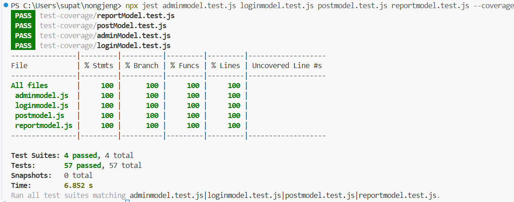


## รายงาน Static และ Dynamic profiling

### Static profiling

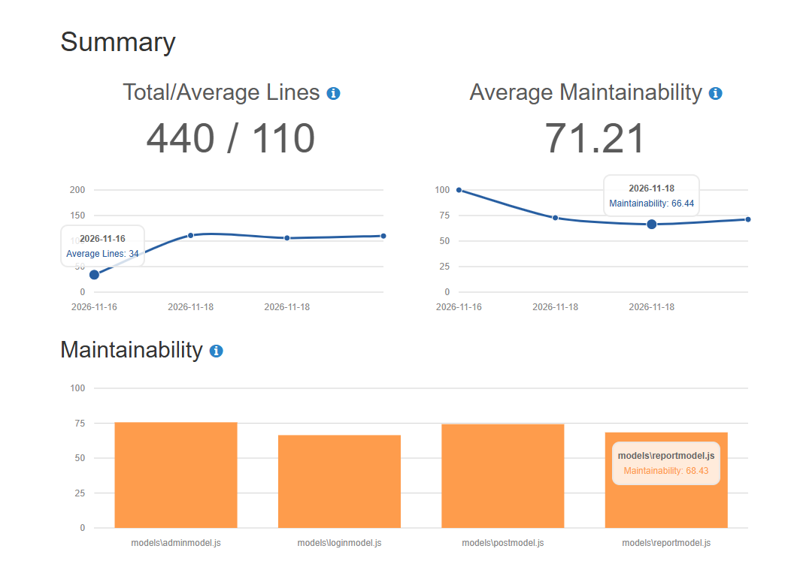
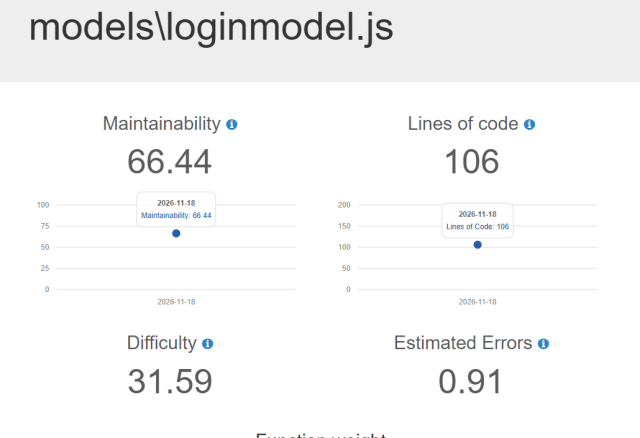
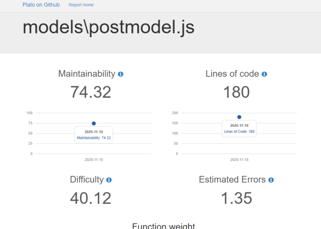
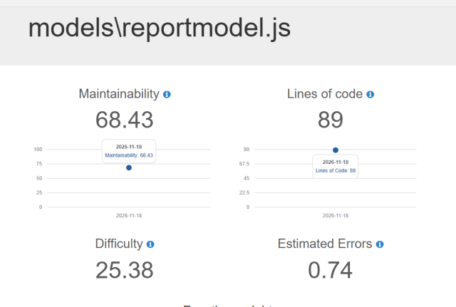
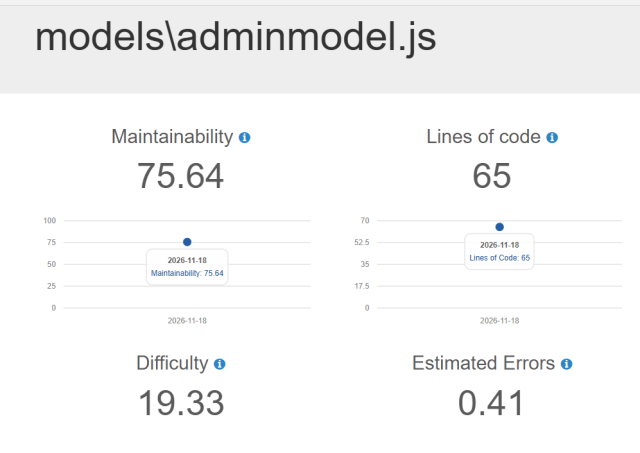
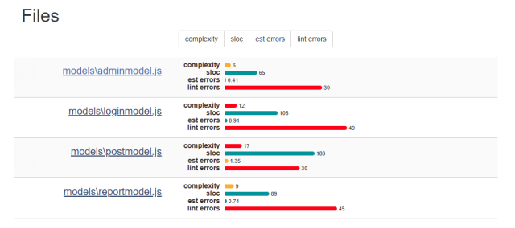

ตารางสรุปข้อมูล Static profiling :

| ลำดับ | Model.js | Maintainability (Point) | Line of code (lines) | Difficulty (Point) | Estimated Errors (errors) |
| :--- | :--- | :--- | :--- | :--- | :--- |
| 1 | loginmodel.js | 66.44 | 106 | 31.59 | 0.91 |
| 2 | postmodel.js | 74.32 | 180 | 40.12 | 1.35 |
| 3 | reportmodel.js | 68.43 | 89 | 25.38 | 0.74 |
| 4 | adminmodel.js | 75.64 | 65 | 19.33 | 0.41 |

### Dynamic profiling

1) ตอน run หน้าเว็บ
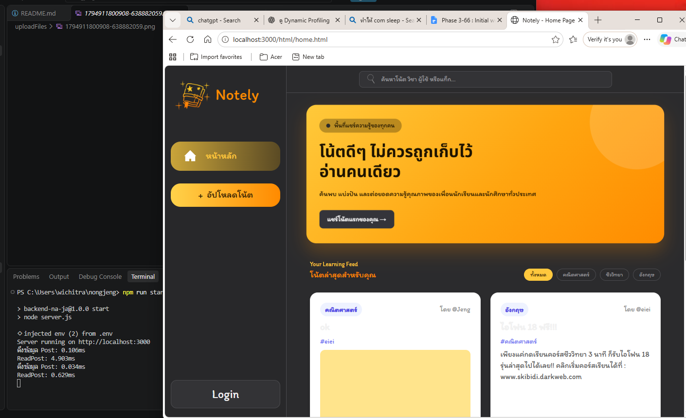
2) ตอน login
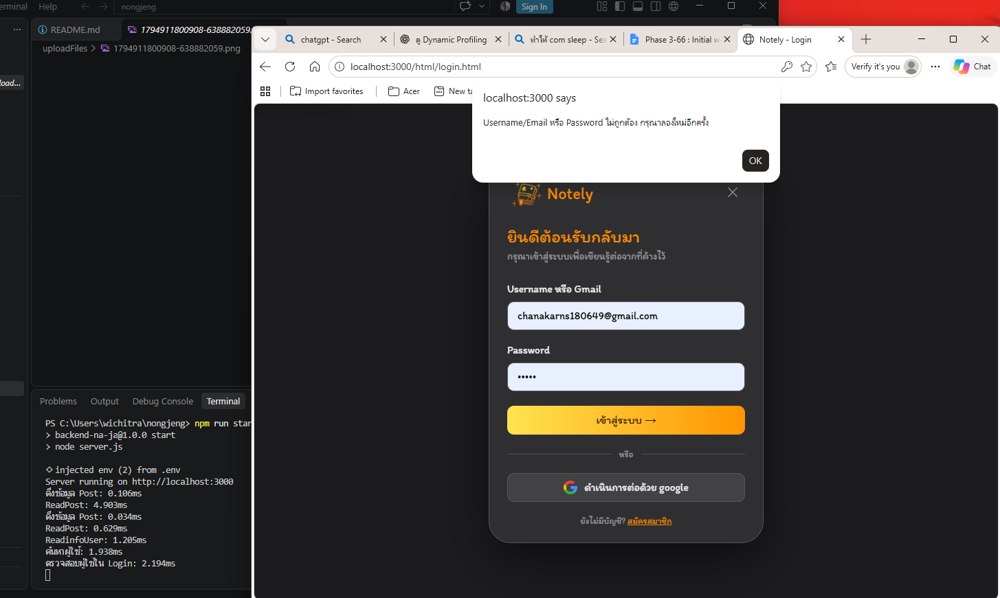
3) ตอนสมัครเข้าใช้งานสำเร็จ
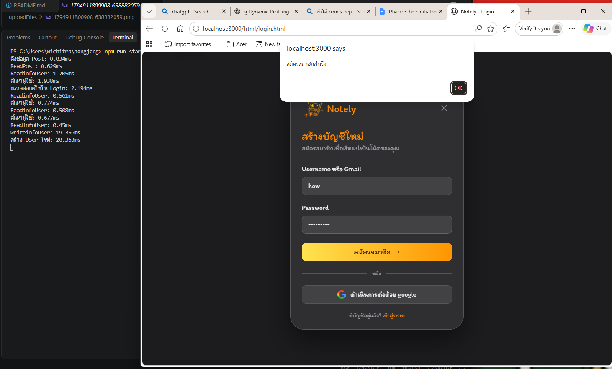
4) ตอนสร้าง post สำเร็จ
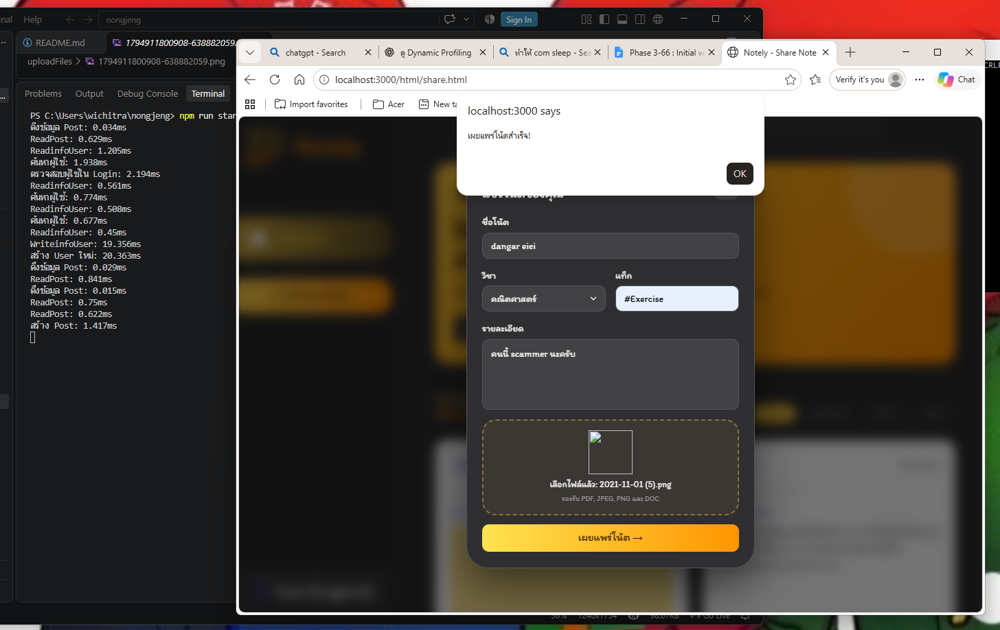
5) ตอนแก้ไขโพสต์
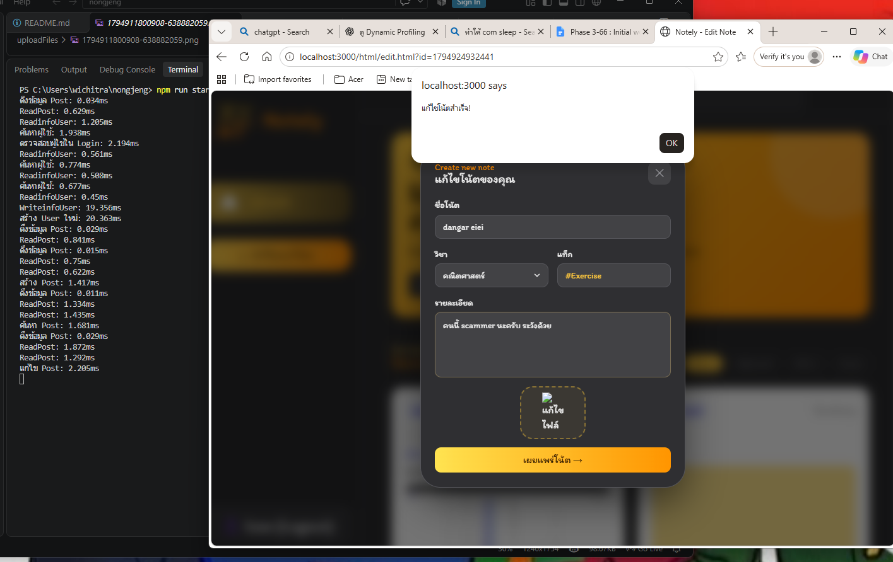
6) ตอนค้นหาใน searchbar โดยพิมพ์ทีละตัวอักษร
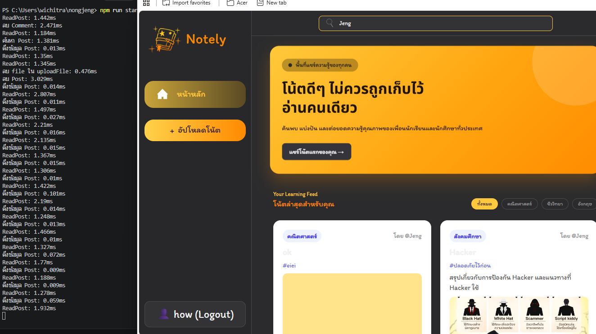
7) ตอน comment ในโพสต์
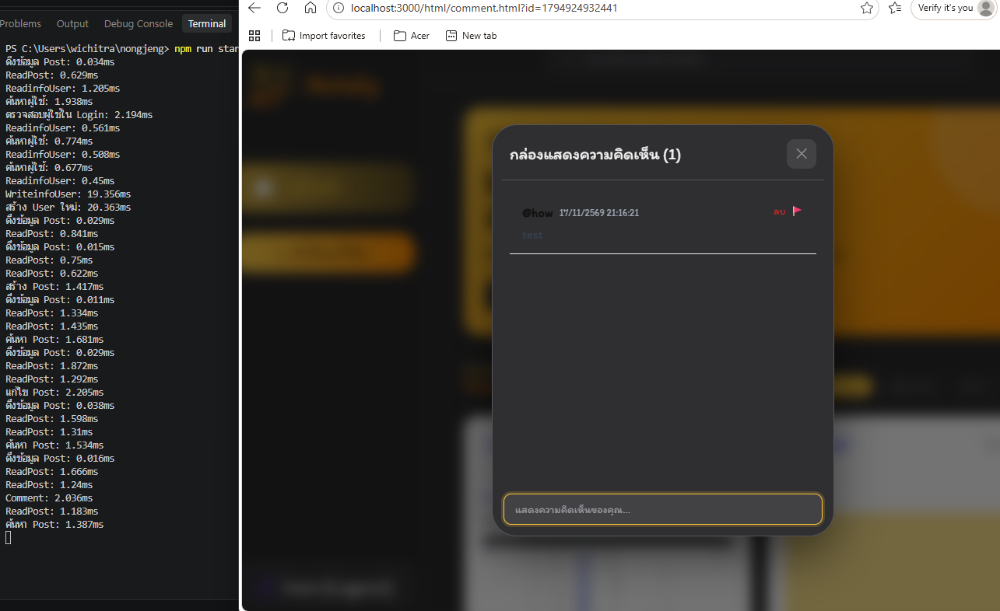
8) ตอนลบ comment
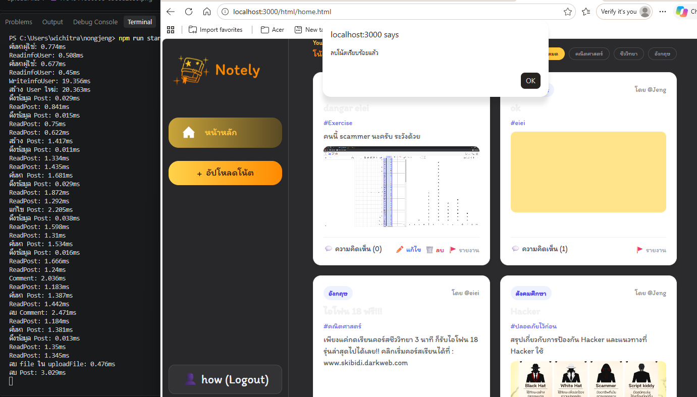
9) ตอน report post
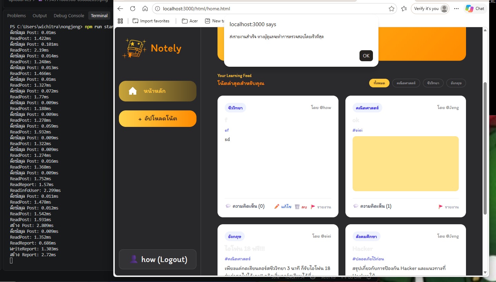
10) ตอน admin อนุมัติหรือลบ report
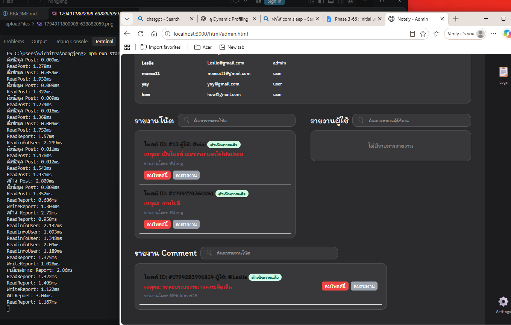

ตารางสรุปข้อมูล Dynamic Profiling :

| ลำดับ | ส่วนการทำงานของระบบ | รายการที่วัดผลการทำงาน | เวลาทำงานที่ปรากฎ (ms)|
| :--- | :--- | :--- | :--- |
| 1 | login | ReadinfoUser | 0.450 - 2.299 |
| 2 | login | ค้นหาผู้ใช้ | 0.774 - 1.938 |
| 3 | login | ตรวจสอบผู้ใช้ใน login | 1.547 - 2.194 |
| 4 | register | WriteinfoUser | 18.814 - 19.356 |
| 5 | register | สร้างผู้ใช้ใหม่ | 19.556 - 20.363 |
| 6 | Post | ReadPost | 0.629 - 4.903 |
| 7 | Post | สร้าง Post | 1.417 - 2.809 |
| 8 | Post | ดึงข้อมูล Post | 0.013 - 0.038 |
| 9 | Post | แก้ไข Post | 1.748 - 2.205 |
| 10 | Post | ลบ Post | 3.029 - 3.998 |
| 11 | Comment | Comment | 1.813 - 2.036 |
| 12 | Comment | ลบ Comment | 1.417 - 2.809 |
| 13 | Report | ReadReport | 0.958 - 1.570 |
| 14 | Report | WriteReport | 1.122 - 1.303 |
| 15 | Report | เปลี่ยนสถานะ report | 2.141 - 2.860 |
| 16 | Report | ลบ report | 3.040 - 3.458 |

## สิ่งที่ยังไม่เสร็จสมบูรณ์ //เช่น bug, error
| ลำดับ | ประเภทปัญหา | รายละเอียดปัญหา / อาการที่พบ | แนวทางแก้ไขหรือข้ออ้างแก้เกี้ยวเวลาโดนทัก |
| :---: | :--- | :--- | :--- |
| 1 | Concurrency & File Race Condition | เนื่องจากใช้ File System บันทึกข้อมูลลงไฟล์ JSON โดยตรง หากมีผู้ใช้งานหลายคนกดส่งข้อมูลพร้อมกันเป๊ะๆ อาจเกิดอาการเขียนไฟล์ทับกัน ทำให้ข้อมูลบางรายการหายไป | หากใช้งานจริงใน Production จะถูกเปลี่ยนไปใช้ Relational Database เช่น PostgreSQL หรือ MongoDB แทน |
| 2 | Security / Plaintext Password | รหัสผ่านของผู้ใช้งานถูกเก็บเป็น Plaintext ในไฟล์ users.json โดยยังไม่ได้ทำการเข้ารหัส เช่น การใช้ bcrypt | เป็นเวอร์ชันจำลองสำหรับการศึกษาพื้นฐานโครงสร้างระบบ หากนำไปใช้งานจริงจะต้องผ่านกระบวนการ Hashing Password และเพิ่มระบบ JWT Authentication ต่อไป |
| 3 | File Upload Vulnerability | ระบบอัปโหลดไฟล์ผ่าน Multer ยังไม่มีการตรวจสอบนามสกุลไฟล์หรือประเภทไฟล์อย่างเข้มงวดพอ ผู้ใช้อาจเผลออัปโหลดไฟล์อันตราย เช่น ไฟล์สคริปต์ .exe, .js เข้าสู่โฟลเดอร์ uploadFiles ได้ | จำกัดขนาดไฟล์เบื้องต้นไว้แล้ว แต่ยังไม่ได้ทำ Strict Mime-type Filtering ซึ่งเป็นจุดที่ต้องพัฒนาเพิ่มเรื่อง File Security ในเฟสถัดไป |
| 4 | State Management & LocalStorage | สถานะการล็อกอินพึ่งพา localStorage ฝั่ง Frontend เพียงอย่างเดียว หากผู้ใช้งานลบข้อมูลเบราว์เซอร์หรือเปิดโหมด Incognito สิทธิ์การเป็น Admin หรือสถานะ User จะหลุดทันทีโดยไม่มี Session ข้ามฝั่ง Server คอยเช็คความปลอดภัยแบบ Real-time | เน้นความเรียบง่ายในการเชื่อมต่อหน้า HTML ดึงข้อมูลผ่าน REST API แบบ Stateless หากจะทำระบบจริงจังจะเพิ่ม Secure Cookie และ Session Management |
| 5 | UI Responsiveness & Edge Cases | หน้าจอแดชบอร์ด Admin หรือหน้า home.html เมื่อมีข้อความยาวมากๆ หรือโพสต์ชื่อหัวข้อยาวเกินกำหนด อาจทำให้ Grid Layout ยืดแตกหรือตกบรรทัดในหน้าจอขนาดเล็ก | ระบบถูกออกแบบมาให้รองรับ Desktop View เป็นหลัก สำหรับเวอร์ชันหน้าจอพกพาต้องปรับปรุง CSS Media Queries เพิ่มเติม |
| 6 | Login system | เมื่อกดปุ่ม Login with Google ระบบไม่สามารถดำเนินการเข้าสู่ระบบได้ตามปกติ | ปรับปรุงและแก้ไขการทำงานของ Backend ในส่วนการเข้าสู่ระบบผ่าน Google เพื่อให้สามารถเข้าสู่ระบบได้อย่างถูกต้อง |

### Website screenshot 
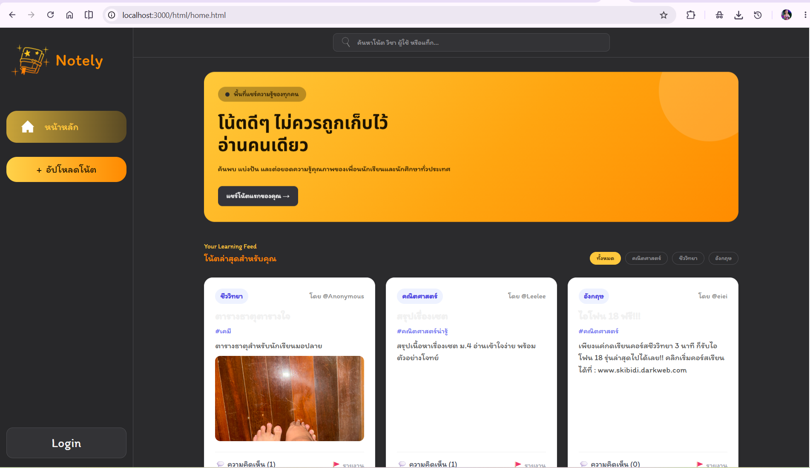

## สิ่งเปลี่ยนแปลงจาก รายงาน phase 1 and 2 
| มิติการพัฒนา | Phase 1 (ช่วงเริ่มต้น/โครงสร้างพื้นฐาน) | Phase 2 (ช่วงต่อยอดและยกระดับระบบ) |
| :--- | :--- | :--- |
| **1. ขอบเขตฟังก์ชัน (Feature Scope)** | • เน้นการสร้างระบบแกนหลัก (Core Features)<br>• ระบบสมาชิก (Login/Register)<br>• การอัปโหลดไฟล์และสร้างโพสต์โน้ตพื้นฐาน<br>• ระบบคอมเมนต์และระบบแสดงผลหน้า Home | • ขยายสู่ฟังก์ชันขั้นสูงและการบริหารจัดการระบบ<br>• ระบบแดชบอร์ดผู้ดูแลระบบ (Admin Dashboard) เต็มรูปแบบ<br>• ระบบจัดการรายงานความไม่เหมาะสม (Reporting System) แยกตามประเภท (โน้ต, ผู้ใช้, คอมเมนต์)<br>• ระบบแบน/ปลดแบนผู้ใช้และการจัดการโพสต์เจ้าปัญหา |
| **2. โครงสร้างข้อมูล (Data Structure)** | • ออกแบบโครงสร้างข้อมูล JSON 3 ไฟล์หลัก (`users.json`, `posts.json`, `report.json`) แบบเรียบง่าย<br>• ยังพบปัญหาความไม่สอดคล้องของชื่อฟิลด์ (เช่น สะกดคำว่า `description` ผิดเป็น `desciption` หรือรายงานยังไม่มีฟิลด์ `type`) | • ทำ Data Cleaning และ Normalize โครงสร้าง JSON ให้เป็นมาตรฐานเดียวกัน 100%<br>• เพิ่มฟิลด์เชื่อมโยงความสัมพันธ์ เช่น ฟิลด์ `type` ในรายงาน, การจัดหมวดหมู่แท็ก และการจัดการไฟล์แนบให้ตรงกับเส้นทางจริง (`uploadFiles/`) |
| **3. การทดสอบระบบ (Quality Assurance)** | • เน้นการทดสอบแบบ Manual Testing บนหน้าเว็บผ่านเบราว์เซอร์ทีละหน้า<br>• ยังไม่มีการทำ Automated Testing | • ยกระดับสู่มาตรฐานทางวิศวกรรมด้วยการเขียน Automated Unit Testing ผ่านเฟรมเวิร์ก Jest<br>• แยกไฟล์ทดสอบออกเป็น 12 ไฟล์ย่อย (`TC-01` ถึง `TC-12`) ครอบคลุมทั้ง Happy Paths และ Edge Cases |
| **4. ความปลอดภัยและการจัดการข้อผิดพลาด (Security & Edge Cases)** | • เน้นการทำงานให้สำเร็จ (Happy Path)<br>• ยังมีความเสี่ยงเรื่องข้อมูลรั่วไหล เช่น อาจส่งฟิลด์รหัสผ่านติดไปกับ Response<br>• การจัดการข้อมูลขยะหรือข้อมูลที่แหว่งยังไม่รัดกุม | • เพิ่มการตรวจสอบระดับ Edge Cases และ Security เช่น<br>- การตัดฟิลด์ `password` ออกจาก JSON ก่อนส่งออกเสมอ (Data Leak Prevention)<br>- การป้องกันข้อมูล JSON ที่โครงสร้างแหว่งหรือเสียหายไม่ให้เซิร์ฟเวอร์ล่ม (500 Error)<br>- การดักจับข้อมูลป้อนเข้า เช่น คอมเมนต์ช่องว่างล้วน หรือแปลงชนิดข้อมูล String เป็น Number (Type Coercion) |
| **5. เอกสารประกอบโครงการ (Documentation)** | • เน้นการเขียนโค้ดและสร้างหน้า HTML/CSS/JS พื้นฐาน | • จัดทำเอกสารชุดใหญ่เพื่อการส่งมอบ เช่น ตาราง Test Cases สำหรับ `README.md`, รายงานผลการทดสอบ (Test Coverage Report), ตารางวิเคราะห์ Static & Dynamic Profiling, และเอกสารโครงสร้างข้อมูล (Data Structure & Class Architecture) |

### เหดุผลที่เปลี่ยน : 
**อาจารย์สั่งให้เปลี่ยน**

### ขั้นตอนการสรุป Retrospective 
## ลิงก์การรับชม
- Retrospective: https://youtu.be/LkpN0vIXSyY

## สรุปการประชุม

### Process การทำงาน
- มอบหมายงานให้กับสมาชิกภายในกลุ่ม
- เขียน Frontend, Backend, และ Javascript เสร็จสิ้น
- ทำ Profiling และ Test Converage
- ตรวจสอบ bugs ต่างๆด้วย Test Case
- จัดการเนื้อหารายงาน


### สิ่งที่ทำได้ดี 
- ความรับผิดชอบทุกคนรู้หน้าที่และทำงานในส่วนของตนเองอย่างเต็มที่
- ความพยายามทุกคนพยายามทำงานแม้ต้องเผชิญกับอุปสรรค
- การรับฟังพร้อมรับฟังความคิดเห็นและข้อเสนอแนะของเพื่อน
- การแก้ไขปัญหาก็มักจะช่วยกันเสนอแนวทางและแก้ไขปัญหาร่วมกัน
- การทำงานเป็นทีมก็ให้ความร่วมมือกันตลอดทั้ง Phase เพื่อให้งานสำเร็จตามเป้าหมาย


### ปัญหาที่เกิดขึ้นระหว่างทำงาน/สิ่งที่ควรปรับปรุง
- งาน Open House เบียดงาน
- งานวิชาอื่นๆเข้ามาแทรก
- ทำให้ไม่สามารถจัดเวลาได้ เพราะงานที่โถมเข้ามา High priority หมด
- ปัญหาสุขภาพจากงาน Open house และจากงานวิชาอื่นๆจนสมาชิกทุกคนไม่มีแรงกำลังใจทำ
สิ้งที่ควรปร้บปรุง
- ครั้งหน้าควรเริ่มไวกว่านี้ (คืออาจารย์สั่งงานแล้วต้องทำเลย)


### ข้อเสนอแนะ
- ใน phase หน้า อาจจะต้องทำงานให้เร็วก่อนนี้ เพื่อป้องกันการเกิดเหตุสุดวิสัย
- ควรหาเวลาที่เหมาะสมกับทุกคนมากกว่านี้ อย่างการหาเวลาหรือช่วลเวลาที่เหมาะร่วมกัน


### Feedback การทำงานของกลุ่ม
- โดยรวมสมาชิกทำงานร่วมกันได้ดี 
- มีการแบ่งหน้าที่ค่อนข้างชัดเจน และหากสมาชิกคนใดทำส่วนใดไม่ได้ เพื่อนในกลุ่มก็พร้อมช่วยเหลือ
- สมาชิกช่วยกันเสนอความคิดเห็น แก้ไขปัญหา และสนับสนุนกันระหว่างทำงาน

### สรุปโดยรวม
โดยรวมแล้ว กลุ่มทำงานร่วมกันได้ดี มีการแบ่งหน้าที่ชัดเจน สมาชิกทุกคนมีความรับผิดชอบและพยายามทำงานอย่างเต็มที่ ทุกคนรับฟังความคิดเห็น ช่วยเหลือกัน และร่วมกันแก้ไขปัญหาที่เกิดขึ้น
อย่างไรก็ตาม กลุ่มพบปัญหาด้านการบริหารเวลา เนื่องจากมีงาน Open House และงานวิชาอื่นเข้ามาพร้อมกัน ทำให้มีเวลาทำงานน้อยลงและเกิดความเหนื่อยล้า
สำหรับ Phase ถัดไป กลุ่มควรเริ่มทำงานทันทีที่ได้รับมอบหมาย วางแผนและจัดลำดับความสำคัญของงานให้ดีขึ้น รวมถึงหาเวลาทำงานร่วมกันที่เหมาะสม เพื่อให้งานสำเร็จตามเป้าหมายและลดปัญหาที่อาจเกิดขึ้น
<<<<<<< HEAD

=======
>>>>>>> 5ad3bb473903cd0aa6ef92f9d2f96e998f9d5914
