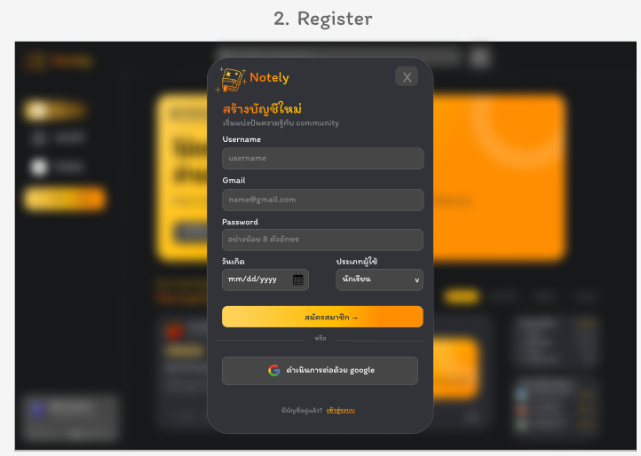
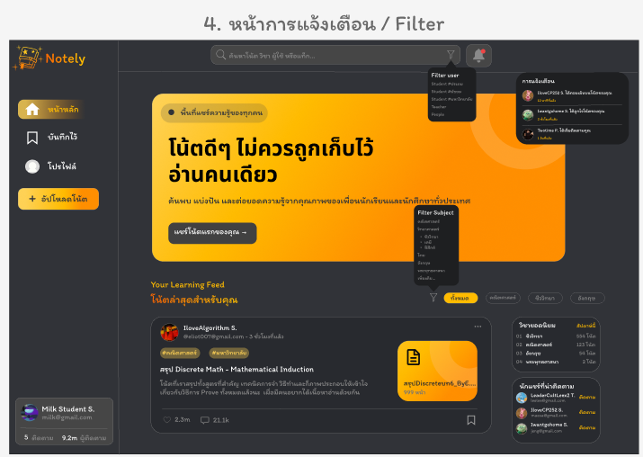
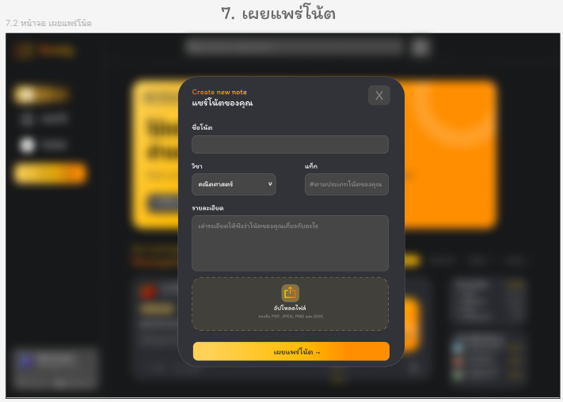
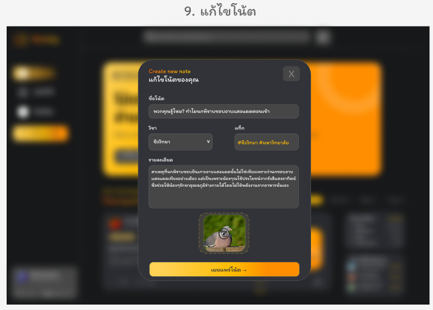
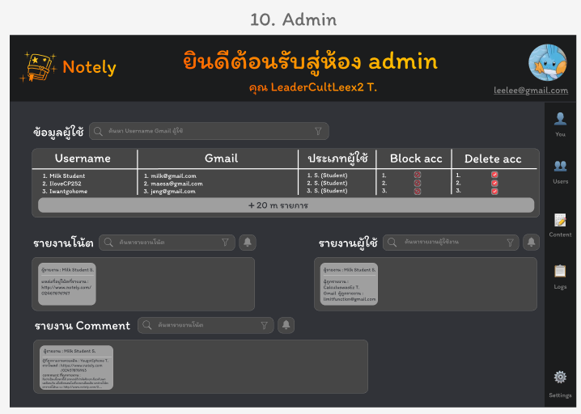

# เว็บ Notely

## รายชื่อสมาชิกกลุ่ม (Team Members)

| ลำดับ | รหัสนิสิต | ชื่อ - นามสกุล | บทบาท
| :---: | :---: | :---: | ---: |
| 1 | 68102010213 | นางสาววริศรา ทองสุข | UI Design, HTML & CSS |
| 2 | 68102010550 | นายชนกานต์ หิรัญสุขสันต์ | UI Design, Test Case |
| 3 | 68102010553 | นางสาวพรนัชชา อออุดมยุทธ | Diagram, Backend, JSON |
| 4 | 68102010562 | นางสาวศุภธิดา พาภิรมย์ | Diagram, JavaScript, Overview |

## เสนอ

ผู้ช่วยศาสตราจารย์ ดร.วีรยุทธ เจริญเรืองกิจ

โครงงานนี้เป็นส่วนหนึ่งของการศึกษารายวิชา คพ252 วิศวกรรมซอฟต์แวร์  
มหาวิทยาลัยศรีนครินทรวิโรฒ  
ภาคการศึกษาที่ 2 ปีการศึกษา 2569

---

## ที่มาของปัญหาและความสำคัญ

ปัจจุบันการเรียนของนักศึกษาไม่ได้มีแค่การเรียนในห้องเรียนเพียงอย่างเดียว แต่ยังมีการค้นหาข้อมูลเพิ่มเติมจากอินเทอร์เน็ต รวมถึงการแลกเปลี่ยนความรู้และเอกสารการเรียนกับเพื่อนผ่านช่องทางต่าง ๆ เช่น กลุ่มแชตหรือโซเชียลมีเดีย ซึ่งบางครั้งข้อมูลที่ใช้ในการเรียนมีการกระจายอยู่หลายที่ ทำให้ค้นหาเอกสารหรือเนื้อหาที่ต้องการได้ยาก และเมื่อเวลาผ่านไปอาจทำให้ไฟล์หรือข้อมูลบางส่วนหาไม่เจอ

จากปัญหานี้จึงเกิดแนวคิดในการสร้างเว็บไซต์สำหรับแบ่งปันความรู้และเนื้อหาการเรียนสำหรับนักศึกษา โดยให้ผู้ใช้งานสามารถนำโน้ตหรือเอกสารที่มีมาแบ่งปันให้กับนักศึกษาคนอื่น ๆ สามารถเข้ามาดูและนำไปใช้ในการเรียนหรือทบทวนบทเรียนได้ นอกจากนี้ยังสามารถจัดหมวดหมู่เนื้อหาตามวิชาและเพิ่ม Tag เพื่อให้ค้นหาเนื้อหาที่สนใจได้ง่ายขึ้น

นอกจากการแบ่งปันเนื้อหาแล้ว เว็บไซต์ยังมีฟังก์ชันที่ช่วยให้ผู้ใช้งานสามารถติดตามกัน กด Like และ Comment เพื่อแลกเปลี่ยนความคิดเห็นเกี่ยวกับเนื้อหาที่แบ่งปัน รวมถึงมีระบบแจ้งเตือนเพื่อให้ผู้ใช้งานทราบเมื่อมีคนติดตาม กด Like หรือแสดงความคิดเห็นในโพสต์ของตนเอง ทำให้เว็บไซต์มีลักษณะคล้ายกับชุมชนเล็ก ๆ ที่นักศึกษาสามารถเข้ามาแบ่งปันและช่วยเหลือกันในเรื่องการเรียนได้

ในส่วนของการจัดการระบบ จะมีผู้ดูแลระบบ (Admin) สำหรับตรวจสอบและจัดการเนื้อหาหรือผู้ใช้งานที่ไม่เหมาะสม โดยผู้ใช้งานสามารถ Report เนื้อหาหรือบัญชีที่พบว่ามีปัญหา เพื่อให้ Admin เข้ามาตรวจสอบและดำเนินการตามความเหมาะสม รวมถึงมีการเก็บประวัติการแก้ไขโน้ต เพื่อให้สามารถตรวจสอบการเปลี่ยนแปลงของข้อมูลย้อนหลังได้

ดังนั้น โครงการนี้จึงจัดทำขึ้นเพื่อช่วยให้นักศึกษาสามารถแบ่งปันและเข้าถึงเนื้อหาการเรียนได้ง่ายขึ้น รวมถึงช่วยให้การค้นหาและทบทวนบทเรียนมีความสะดวกมากขึ้น และเป็นพื้นที่สำหรับให้นักศึกษาได้แลกเปลี่ยนความรู้และประสบการณ์ระหว่างกัน ซึ่งคาดว่าจะช่วยส่งเสริมการเรียนรู้ร่วมกันและสร้างสังคมแห่งการเรียนรู้ภายในเว็บไซต์ได้

## จุดประสงค์ของ Project

- เพื่อช่วยให้นักศึกษาสามารถแบ่งปันความรู้และเข้าถึงเนื้อหาการเรียนได้อย่างสะดวกและรวดเร็ว
- เพื่อส่งเสริมการเรียนรู้ร่วมกันระหว่างนักศึกษาผ่านการแลกเปลี่ยนความรู้และประสบการณ์ในการเรียน
- เพื่อช่วยเพิ่มประสิทธิภาพในการทบทวนบทเรียนและการเตรียมความพร้อมสำหรับการเรียนของนักศึกษา
- เพื่อสร้างกลุ่มหรือชุมชนแห่งการเรียนรู้ที่ผู้ใช้งานสามารถแสดงหรือแลกเปลี่ยนความคิดเห็น และช่วยเหลือกันด้านการเรียนผ่านเว็บไซต์นี้

## ประโยชน์ที่คาดว่าจะได้รับ

- เพื่อให้สามารถกำหนดความต้องการของระบบได้อย่างชัดเจน และสอดคล้องกับความต้องการของผู้ใช้งาน
- เพื่อใช้เป็นแนวทางในการออกแบบและพัฒนาระบบ ให้เป็นไปตามขอบเขตและวัตถุประสงค์ของโครงการ
- เพื่อเป็นการลดความผิดพลาดและความคลาดเคลื่อนในการพัฒนาระบบ ทำให้ผู้ที่เกี่ยวข้องมีความเข้าใจตรงกัน
- เพื่อที่จะใช้เป็นเกณฑ์ในการตรวจสอบและประเมินระบบ ว่าสามารถทำงานได้ตามความต้องการที่กำหนดไว้

## ขอบเขตของ Project

- เป็นเว็บไซต์สำหรับแบ่งปันไฟล์และเนื้อหาที่เกี่ยวข้องกับการเรียนรู้และการศึกษาเท่านั้น
- เว็บไซต์รองรับการใช้งานเฉพาะภาษาไทย
- ผู้ใช้งานสามารถอัปโหลดไฟล์และสร้างโพสต์ เพื่อแบ่งปันเนื้อหาการเรียนรู้ได้ แต่ไม่สามารถแก้ไขไฟล์ที่เผยแพร่ไปแล้วได้
- ผู้ใช้งานสามารถสร้างกลุ่มและเชิญผู้ที่ใช้งานบนเว็บไซต์เข้าร่วมกลุ่มได้เพื่อแลกเปลี่ยนและแบ่งปันเนื้อหาภายในกลุ่ม
- ผู้ใช้จะต้องเข้าสู่ระบบก่อนเข้าใช้งาน
- ผู้ใช้งานสามารถแสดงความคิดเห็นและมีส่วนร่วมกับโพสต์ของผู้ใช้งานอื่นได้
- ผู้ดูแลระบบสามารถจัดการบัญชีผู้ใช้งานและเนื้อหาภายในเว็บไซต์ เพื่อควบคุมเนื้อหาที่ไม่เหมาะสม
- ระบบการโพสต์โน้ตรองรับการอัปโหลดไฟล์ในรูปแบบ PDF, JPG และ PNG เท่านั้น

# Functional and Non-Functional Requirement

## 1. Functional Requirement

| ID | รายละเอียด |
| :--- | :--- |
| **FR-01** | ระบบรองรับการเข้าสู่ระบบ (Log in) โดยผู้ใช้งานสามารถใช้บัญชี Gmail ร่วมกับ Username และ Password ในการยืนยันตัวตนเข้าสู่ระบบ |
| **FR-02** | ผู้ใช้งานสามารถสมัครสมาชิกโดยระบุข้อมูล Username หรือ Gmail พร้อมกำหนด Password สำหรับใช้ในการเข้าสู่ระบบในครั้งถัดไป |
| **FR-03** | ระบบมีการจัดการ Token สำหรับรักษาสถานะการเข้าสู่ระบบของผู้ใช้งานเป็นระยะเวลา 1 เดือน โดยไม่ต้องกรอกข้อมูลใหม่หากยังไม่หมดอายุ |
| **FR-04** | ระบบรองรับการออกจากระบบ (Log out) โดยจะยกเลิก Token ทันทีเพื่อป้องกันการเข้าถึงบัญชีโดยไม่ได้รับอนุญาต |
| **FR-05** | ผู้ใช้งานสามารถจัดการข้อมูลส่วนตัวภายในโปรไฟล์ได้ เช่น การเปลี่ยนรูปโปรไฟล์ (Profile Picture) และการแก้ไขประวัติส่วนตัว (Bio) |
| **FR-06** | ระบบจัดเก็บข้อมูลวันเกิดและช่วงอายุของผู้ใช้งานในขั้นตอนการสมัครสมาชิก เพื่อนำมาใช้ในการจำแนกเนื้อหาตามกลุ่มเป้าหมาย |
| **FR-07** | ผู้ใช้งานสามารถกดปุ่มติดตาม (Follow) หน้าโปรไฟล์ของผู้ใช้งานรายอื่น และระบบจะปรับปรุงจำนวน Follower/Following โดยอัตโนมัติ |
| **FR-08** | ระบบรองรับการสร้างและเผยแพร่โน้ต (Notes) พร้อมอัปโหลดไฟล์เอกสารในรูปแบบ PDF, JPG, PNG และ DOC |
| **FR-09** | ผู้ใช้งานสามารถเพิ่มแท็ก (Tag) ให้กับโน้ตหรือโพสต์ เพื่อจัดหมวดหมู่และช่วยในการค้นหาเนื้อหาที่สนใจ |
| **FR-10** | ระบบรองรับการแก้ไขเนื้อหาโน้ตและการอัปเดตไฟล์เวอร์ชันปัจจุบันให้เป็นข้อมูลล่าสุด |
| **FR-11** | ระบบมีการจัดเก็บประวัติการแก้ไขของโน้ตและเอกสารย้อนหลัง พร้อมบันทึกวันและเวลาที่ดำเนินการแก้ไข |
| **FR-12** | ผู้ใช้งานสามารถมีส่วนร่วมกับโพสต์หรือโน้ตผ่านการกดถูกใจ (Like) และแสดงความคิดเห็น (Comment) |
| **FR-13** | ระบบรองรับการค้นหาข้อมูลภายในระบบ ทั้งผู้ใช้งาน (Users) โน้ต (Notes) วิชา (Subjects) และแท็ก (Tag) |
| **FR-14** | ระบบรองรับการใช้ตัวกรอง (Filter) เพื่อจำกัดขอบเขตผลการค้นหาตามเงื่อนไข เช่น ประเภทโน้ต หมวดหมู่ วิชา หรือแท็ก |
| **FR-15** | ระบบรองรับการแจ้งเตือนกิจกรรมต่างๆ ภายในระบบ (เช่น ผู้ติดตาม, การถูกใจ, ความคิดเห็น, การถูกระงับบัญชี และการลบโพสต์โดยแอดมิน) ทั้งในระบบและทาง Email |
| **FR-16** | ผู้ดูแลระบบ (Admin) มีสิทธิ์พิเศษในการบริหารจัดการ ตรวจสอบ และจัดการพฤติกรรมหรือเนื้อหาที่ไม่เหมาะสม รวมถึงการจัดการคำร้องรายงาน (Report) |

## 2. Non-Function Requirement

| ID | รายละเอียด |
| :--- | :--- |
| **NFR-08** | ระบบต้องรักษาความปลอดภัยของข้อมูลบัญชีผู้ใช้งาน โดยรหัสผ่านต้องได้รับการจัดเก็บในรูปแบบที่ปลอดภัย และไม่สามารถเข้าถึงหรือเปิดเผยรหัสผ่านของผู้ใช้งานได้โดยไม่ได้รับอนุญาต |
| **NFR-09** | ระบบต้องป้องกันการเข้าถึงข้อมูลของผู้ใช้งานโดยไม่ได้รับอนุญาต รวมถึงป้องกันการเข้าถึงบัญชีหรือข้อมูลสำคัญผ่านช่องทางที่ไม่ถูกต้อง |
| **NFR-10** | ระบบต้องมีการจัดการ Token สำหรับการเข้าสู่ระบบอย่างปลอดภัย โดย Token ต้องมีอายุการใช้งานตามที่กำหนด และเมื่อผู้ใช้งานออกจากระบบ Token เดิมต้องไม่สามารถนำกลับมาใช้เพื่อเข้าถึงบัญชีได้ |
| **NFR-11** | ระบบต้องตรวจสอบสิทธิ์ของผู้ใช้งานก่อนเข้าถึงหรือดำเนินการกับข้อมูลภายในระบบ โดยผู้ใช้งานสามารถเข้าถึงเฉพาะข้อมูลและฟังก์ชันที่ตนเองมีสิทธิ์ใช้งาน |
| **NFR-12** | ระบบต้องตรวจสอบสิทธิ์ก่อนดำเนินการอัปโหลด สร้าง แก้ไข หรือลบโน้ต เพื่อป้องกันไม่ให้ผู้ใช้งานอื่นสามารถแก้ไขหรือจัดการข้อมูลโดยไม่ได้รับอนุญาต |
| **NFR-13** | ระบบต้องแยกสิทธิ์ระหว่างผู้ใช้งานทั่วไปและผู้ดูแลระบบ (Admin) โดยฟังก์ชันสำหรับจัดการผู้ใช้งาน รายงาน และเนื้อหาที่ไม่เหมาะสมต้องสามารถเข้าถึงได้เฉพาะผู้ดูแลระบบที่ได้รับสิทธิ์เท่านั้น |
| **NFR-14** | ระบบต้องมีการออกแบบส่วนติดต่อผู้ใช้งาน (UI) ให้มีความสวยงาม ทันสมัย และมีรูปแบบที่สอดคล้องกันตลอดทั้งระบบ |
| **NFR-15** | ระบบกำหนดพื้นหลังของเว็บแอปพลิเคชันเป็นโทนสีดำอมเทาเข้ม โดยใช้สี `#313338` เป็นสีหลัก |
| **NFR-16** | กล่องโพสต์และกล่องข้อความใช้โทนสีเหลืองอมส้ม โดยข้อความภายในกล่องใช้สีดำเพื่อให้สามารถอ่านได้อย่างชัดเจน |
| **NFR-17** | ข้อความหรือองค์ประกอบข้อความบนพื้นที่หลักของระบบใช้การไล่เฉดสีในแนวทแยงจากโทนสีเหลืองไปยังสีส้ม เพื่อสร้างความโดดเด่นและความสอดคล้องของรูปแบบการออกแบบ |
| **NFR-18** | ระบบต้องมีส่วนติดต่อผู้ใช้งาน (UI) ที่เข้าใจง่าย และจัดวางฟังก์ชันต่าง ๆ อย่างเป็นระเบียบ เพื่อให้ผู้ใช้งานสามารถเรียนรู้และใช้งานระบบได้สะดวก ทั้งการค้นหา การติดตาม และการจัดการโปรไฟล์ |
| **NFR-19** | ระบบต้องสามารถตอบสนองต่อการใช้งานได้อย่างรวดเร็ว ไม่เกิดอาการกระตุกหรือหน่วงระหว่างการใช้งานในระดับที่ส่งผลกระทบต่อประสบการณ์ของผู้ใช้งาน |
| **NFR-20** | ระบบต้องสามารถเปิดและเข้าสู่เว็บไซต์ได้อย่างรวดเร็ว และใช้ทรัพยากรของอุปกรณ์อย่างเหมาะสม โดยไม่ใช้หน่วยความจำ (RAM) มากเกินความจำเป็น |
| **NFR-21** | ระบบต้องสามารถประมวลผลและแสดงผลข้อมูล เช่น โพสต์ โน้ต และผลการค้นหาได้อย่างมีประสิทธิภาพ |
| **NFR-22** | ระบบต้องสามารถรองรับผู้ใช้งานพร้อมกันได้อย่างน้อย 1,000 คน โดยระบบยังสามารถทำงานได้อย่างต่อเนื่องและไม่เกิดความผิดพลาดหรือระบบล่มจากจำนวนผู้ใช้งานที่เพิ่มขึ้น |
| **NFR-23** | ระบบต้องมีการสำรองข้อมูลอย่างสม่ำเสมอ เพื่อป้องกันการสูญหายของข้อมูลที่ผู้ใช้งานจัดเก็บไว้ภายในระบบ เช่น โน้ต ไฟล์เอกสาร และข้อมูลโปรไฟล์ |
| **NFR-24** | ระบบต้องสามารถกู้คืนข้อมูลจากข้อมูลสำรองได้เมื่อเกิดเหตุขัดข้องหรือข้อมูลสูญหาย เพื่อให้ผู้ใช้งานสามารถกลับมาใช้งานข้อมูลเดิมได้ |
| **NFR-25** | ระบบต้องสามารถแจ้งเตือนผู้ใช้งานเมื่อเกิดกิจกรรมหรือเหตุการณ์ที่เกี่ยวข้องกับบัญชีและเนื้อหาของผู้ใช้งาน โดยแสดงการแจ้งเตือนทั้งภายในระบบและผ่านทางอีเมล |
| **NFR-26** | การแจ้งเตือนต้องสามารถส่งได้อย่างเหมาะสมตามเหตุการณ์ที่เกิดขึ้น และไม่ส่งผลกระทบต่อประสิทธิภาพโดยรวมของระบบ |
| **NFR-27** | ระบบไม่จำกัดจำนวนครั้งในการอัปโหลดโน้ตของผู้ใช้งาน โดยผู้ใช้งานสามารถอัปโหลดโน้ตได้ตามความต้องการ ภายใต้เงื่อนไขและข้อจำกัดทางเทคนิคของระบบ |

# Write TOR according to the requirement

## 1. ระบบ Register, Login และ Logout

- ทุกคนจะต้องเข้าสู่ระบบได้ด้วย Username หรือ Gmail และ Password
- ผู้ใช้สามารถสมัครสมาชิกโดยระบุข้อมูล
  - Username
  - Gmail
  - Password
  - ประเภทผู้ใช้งาน
  - วันเกิด
- ผู้ใช้สามารถกดปุ่มเพื่อ Logout ได้
- ผู้ดูแลระบบสามารถเก็บข้อมูลของผู้ใช้ได้
- ผู้ดูแลระบบสามารถระงับบัญชีผู้ใช้ได้

## 2. ระบบ Profile

- ทุกคนสามารถแก้ไขข้อมูลส่วนตัวและรูปภาพโปรไฟล์ได้ตลอดเวลา
- ผู้ใช้สามารถมองเห็นและกดปุ่ม Follow ได้จากหน้าโปรไฟล์ของผู้อื่น

## 3. ระบบสร้างและเผยแพร่โน้ต

- ผู้ใช้สามารถสร้างโพสต์และอัปโหลดไฟล์ PDF, JPEG, PNG และ DOC ได้
- ผู้ใช้สามารถกดเข้าไปดูรายละเอียดและไฟล์ที่อยู่ข้างในโพสต์ของผู้อื่นได้
- ผู้ใช้สามารถเพิ่ม Tag ให้กับโพสต์เพื่อจัดหมวดหมู่เนื้อหาของโพสต์ได้
- ผู้ใช้สามารถแก้ไขเนื้อหาของโพสต์และการอัปเดตไฟล์ได้ แต่ไม่สามารถแก้ไขเนื้อหาข้างในไฟล์ที่โพสต์ไปแล้วได้
- ผู้ใช้สามารถกดถูกใจ แสดงความคิดเห็น และรายงานโพสต์ของผู้อื่นได้
- ผู้ดูแลระบบสามารถได้รับข้อมูลการรายงานของผู้ใช้ได้
- ผู้ดูแลระบบสามารถลบโพสต์ของผู้ใช้ได้

## 4. ระบบค้นหา

- ผู้ใช้สามารถค้นหาโพสต์ตามชื่อ User, Note, วิชา หรือ Tag ที่ต้องการได้
- ผู้ใช้สามารถใช้ Filter ในการกำหนดเงื่อนไขการค้นหาได้ตามประเภทของโน้ต หมวดหมู่วิชา Tag หรือประเภทผู้ใช้งาน

## 5. ระบบแจ้งเตือน

- ผู้ใช้สามารถได้รับการแจ้งเตือนผ่าน Gmail เมื่อ
  - มีผู้อื่นติดตามคุณ
  - ผู้ที่คุณติดตามได้เพิ่มโพสต์โน้ตใหม่
  - มีผู้อื่นกดถูกใจหรือแสดงความคิดเห็นในโพสต์ของผู้ใช้
  - ผู้ใช้ถูกลบโพสต์
  - ผู้ใช้ถูกระงับบัญชี

## 6. การรองรับของระบบ

- ทุกคนสามารถใช้งานได้ผ่าน Web browser บน PC, iPad และ Android
- Design ของเว็บไซต์จะต้องเปลี่ยนไปตามความเหมาะสมของขนาดหน้าจอของแต่ละ Platform

# Phase 1

# อธิบายกระบวนการทำงาน

## Process

- เก็บรวบรวม Requirements
- ทำเอกสารประกอบโครงงาน
- บันทึกวิดีโอการประชุม Retrospective

## Methods

- เก็บรวบรวม Requirements ด้วยการพูดคุยกับลูกค้า และบันทึกวิดีโอหลักฐาน จากนั้นแบ่งปันวิดีโอให้ผู้อื่น
- ทำเอกสารประกอบโครงงาน โดยโปรแกรมจัดการเอกสาร และแบ่งปันให้ผู้อื่นทำงานกันต่อ
- บันทึกวิดีโอการประชุม Retrospective โดยใช้วิธีการพูดคุย และใช้โปรแกรมบันทึกวิดีโอ และแพลตฟอร์มแบ่งปันวิดีโอ

## Tools

- เก็บรวบรวม Requirements ด้วยการพูดคุยกับลูกค้า โดยผ่านระบบ Google Meet และบันทึกวิดีโอหลักฐานด้วยโปรแกรม OBS จากนั้นแบ่งปันวิดีโอให้ผู้อื่นด้วย YouTube และ Google Drive
- ทำเอกสารประกอบโครงงาน โดยโปรแกรมจัดการเอกสาร Microsoft Word และแบ่งปันให้ผู้อื่นทำงานกันต่อด้วยโปรแกรม Discord หรือระบบ Email
- บันทึกวิดีโอการประชุม Retrospective โดยใช้วิธีการพูดคุยผ่านระบบ Google Meet และใช้โปรแกรมบันทึกวิดีโอด้วยโปรแกรม OBS และแพลตฟอร์มแบ่งปันวิดีโอด้วย YouTube

## ขั้นตอนการสรุป Retrospective

### ลิงก์การรับชม

- Review Requirement: https://www.youtube.com/watch?v=gxMcDzbEx9Q
- Retrospective: https://www.youtube.com/watch?v=2laPciH7vDY

## สรุปการประชุม

### Requirement

- กลุ่มได้รับ Requirement มาครบถ้วนตามที่กำหนด
- สมาชิกมองว่า Requirement มีรายละเอียดมากกว่าโจทย์ที่อาจารย์ต้องการในบางส่วน
- มีความกังวลว่าอาจทำงานเกินโจทย์และอาจต้องแก้ไขภายหลัง จึงควรตรวจสอบความเหมาะสมกับอาจารย์ก่อน

### Process การทำงาน

- หลังจากได้รับ Requirement ครบแล้ว ขั้นตอนถัดไปคือการเข้าสู่การออกแบบเว็บไซต์
- ก่อนเริ่มออกแบบ จะต้องให้อาจารย์ช่วยสรุปและตรวจสอบว่าแนวทางของเว็บไซต์มีความเหมาะสมและตรงตามโจทย์หรือไม่

### Feedback การทำงานของกลุ่ม

- โดยรวมสมาชิกทำงานร่วมกันได้ดี เนื่องจากทำงานด้วยกันมาตั้งแต่ปี 1
- มีการแบ่งหน้าที่ค่อนข้างชัดเจน และหากสมาชิกคนใดทำส่วนใดไม่ได้ เพื่อนในกลุ่มก็พร้อมช่วยเหลือ
- สมาชิกช่วยกันเสนอความคิดเห็น แก้ไขปัญหา และสนับสนุนกันระหว่างทำงาน
- ทุกคนมองว่าการทำงานร่วมกันครั้งนี้เป็นประสบการณ์ที่ดีและได้เรียนรู้เรื่องการทำงานเป็นทีม

### ข้อเสีย / สิ่งที่ควรปรับปรุง

- ควรบริหารและแบ่งเวลาให้ดีกว่านี้
- เนื่องจากสมาชิกมีงานหลายอย่าง จึงทำให้เริ่มทำงานใน Phase 1 ค่อนข้างช้า
- แม้สุดท้ายจะสามารถทำงานให้ทันกำหนดส่งได้ แต่ครั้งต่อไปควรเริ่มงานให้เร็วขึ้นและวางแผนเวลาให้เหมาะสมกว่าเดิม

## สรุปโดยรวม

กลุ่มสามารถทำงานร่วมกันได้ดี มีการช่วยเหลือและแบ่งงานกันอย่างเหมาะสม แต่สิ่งที่ควรพัฒนาคือ การบริหารเวลาและการเริ่มงานให้เร็วขึ้น รวมถึงควรตรวจสอบ Requirement กับอาจารย์ให้ชัดเจนก่อนลงมือทำ เพื่อป้องกันการทำงานเกินขอบเขตหรือถูกสั่งให้แก้ไขภายหลัง

# Phase 2

# อธิบายกระบวนการทำงาน

## Process

#### การแบ่งงาน
ทีมจะแบ่งงานให้สมาชิกแต่ละคนรับผิดชอบตามส่วนของระบบ เช่น Login, Profile, Note, Search และ Notification
#### การ Track Status ของ Project
ทีมจะติดตามสถานะของงานโดยแบ่งเป็น To Do, In Progress, Review และ Done เพื่อดูว่างานส่วนไหนทำไปถึงไหนแล้ว
#### การประชุม Scrum
ทีมจะมีการประชุมประมาณ สัปดาห์ละ 2 ครั้ง เพื่ออัปเดตว่างานของแต่ละคนทำถึงไหนแล้ว มีปัญหาอะไร และงานต่อไปที่จะทำคืออะไร
#### การตรวจสอบงาน
เมื่อสมาชิกทำงานเสร็จ จะมีการตรวจสอบว่างานสามารถทำงานได้ตาม Requirement หรือไม่ ก่อนที่จะนำไปรวมกับงานส่วนอื่น
#### การ Retrospective
หลังจากทำงานแต่ละช่วง ทีมจะพูดคุยกันว่าส่วนไหนทำได้ดี ส่วนไหนมีปัญหา และครั้งต่อไปควรปรับปรุงอย่างไร

## Method 

- ทีมจะทำการแบ่งงานให้สมาชิกแต่ละคนรับผิดชอบตามของส่วนของระบบต่างๆ เช่น Login, Profile, Note, Search และ Notification โดยแบ่งตามความถนัดหรือความสนใจในด้านนั้นๆ
- ทีมจะทำการติดตามสถานะของงานโดยแบ่งเป็น To Do, In Progress, Review และ Done เพื่อดูว่างานส่วนไหนทำไปถึงไหนแล้ว โดยการสร้าง Issue ขึ้นมาและจัดกระดานแบบ Kanban Chart
- ทีมมีการประชุมประมาณ สัปดาห์ละ 2 ครั้ง เพื่ออัปเดตว่างานของแต่ละคนทำถึงไหนแล้ว มีปัญหาอะไร และงานต่อไปที่จะทำคืออะไร โดยการผ่านการพูดคุยสื่อสารทั้งทางตรง (การพบปะกัน) และทางอ้อม (สื่อสารผ่านแชทสนทนา)
- เมื่อสมาชิกทำงานเสร็จ จะมีการตรวจสอบว่างานสามารถทำงานได้ตาม Requirement หรือไม่ ก่อนที่จะนำไปรวมกับงานส่วนอื่น โดยผ่านการพูดคุยและความเห็นชอบตามสมาชิกในกลุ่ม และการทดสอบ รวมถึงการสืบค้นข้อมูลว่าเหมาะสมหรือไม่
- หลังจากทำงานแต่ละช่วง ทีมจะพูดคุยกันว่าส่วนไหนทำได้ดี ส่วนไหนมีปัญหา และครั้งต่อไปควรปรับปรุงอย่างไร โดยการสื่อสารโดยตรง (การพบปะกัน) และบันทึกวิดิโอเอาไว้ เพื่อเป็นหลักฐานในการทำงานBranch หลัก
- ใช้การพูดคุยในกลุ่มเพื่อแจ้งปัญหาและอัปเดตงานระหว่างการทำ Project

## Tools

-	GitHub ใช้เก็บ Source Code และจัดการ Branch, Commit และ Pull Request
-	Git ใช้สำหรับจัดการ Version ของ Code และแยกงานของสมาชิกแต่ละคน
-	GitHub Projects ใช้สำหรับติดตามสถานะของงาน เช่น To Do, In Progress, Review และ Done
-	Discord ใช้สำหรับพูดคุยและส่งข้อมูลระหว่างสมาชิกในทีม
-	Google Meet ใช้สำหรับประชุม Scrum และพูดคุยเกี่ยวกับปัญหาของ Project
-	Microsoft Word และ Google Drive ใช้สำหรับทำและเก็บเอกสารของ Project

## UI Screenshot:

## Figma Diagram:

## ขั้นตอนการสรุป Retrospective

### ลิงก์การรับชม

- Retrospective: https://youtu.be/KO6X8XIttr0
- UI Screenshot: https://drive.google.com/drive/folders/1CJodyTcJAFAhOQfCgGUB0xZwUMJ2fjhN
- Figma: https://www.figma.com/design/m14GQcK81j4FF2Lk0uxtAz/Untitled?node-id=41-118&t=5Sf8MBWj5higUf9h-0
- Mermaid Diagram: https://mermaid.ai/view/c995c0b4-67b1-4fae-b0fb-cb5184ae46ba

## สรุปการประชุม

### Process การทำงาน

- สร้าง UI design โดยใช้ Figma
- หลังจากสร้าง UI แล้ว ก็นำข้อมูลไปทำเป็น diagram โดยใช้ Mermaid

### สิ่งที่ทำได้ดี 

- คนในกลุ่มสื่อสารกันได้ดี
- สมาชิกช่วยกันแก้ปัญหาเฉพาะหน้าได้ดีเยี่ยม
- หัวหน้าแบ่งงานลูกทีมได้เท่าเทียมและเหมาะสมกับงาน

### ปัญหาที่เกิดขึ้นระหว่างทำงาน/สิ่งที่ควรปรับปรุง

- การส่งงานล่าช้า เนื่องจากสถานการณ์น้ำท่วม ส่งผลกระทบต่อการใช้ชีวิตและการทำงานร่วมกันของสมาชิก
- ปัญหาสุขภาพ สมาชิกบางคนมีไข้จากสภาพอากาศที่เปลี่ยนแปลงกะทันหัน และบางคนมีอาการภูมิแพ้กำเริบ
- ข้อจำกัดด้านเวลา มีภาระงานหลายส่วนที่ต้องดำเนินควบคู่กัน ทำให้การจัดสรรเวลาและการประสานงานภายในกลุ่มเป็นไปได้ยากขึ้น
- อุปสรรคในการดำเนินชีวิต สมาชิกบางคนต้องรับมือกับน้ำท่วมบ้านและขนย้ายสิ่งของ ทำให้ไม่สามารถทุ่มเทให้กับงานได้อย่างเต็มที่

### ข้อเสนอแนะ

- ใน phase หน้า อาจจะต้องทำงานให้เร็วก่อนนี้ เพื่อป้องกันการเกิดเหตุสุดวิสัย
- ควรหาเวลาที่เหมาะสมกับทุกคนมากกว่านี้ อย่างการหาเวลาหรือช่วลเวลาที่เหมาะร่วมกัน

### Feedback การทำงานของกลุ่ม

- การปรับหน้า UI ในรอบนี้ เป็นมุมมองที่สวยและสร้างสรรค์มาก ตรงกับRequirement ที่เพื่อนต้องการ
- ตัวแทนกลุ่มไปคุยและเคลียร์ Requirement กับเพื่อนจนชัดเจน ทำให้รอบนี้พวกเราทำงานต่อได้แบบลื่นไหล และประหยัดเวลาไปได้เยอะ
- ขอบคุณเพื่อนๆที่คอยเติมพลังบวกและสร้างรอยยิ้มให้ทีมเสมอ
- ขอบคุณตัวเองที่สู้ตายกับโปรเจกต์นี้มาตลอดสัปดาห์

## สรุปโดยรวม

โดยใน Phase 2 จะเน้นการจัดการงานและการทำงานร่วมกันมากกว่า Phase 1 เช่น การ Track งาน การใช้ Git/GitHub การกำหนด Branch และ Commit Message รวมถึงการประชุม Scrum เพื่อให้สมาชิกทุกคนรู้ว่างานของ Project ดำเนินไปถึงขั้นไหนแล้ว